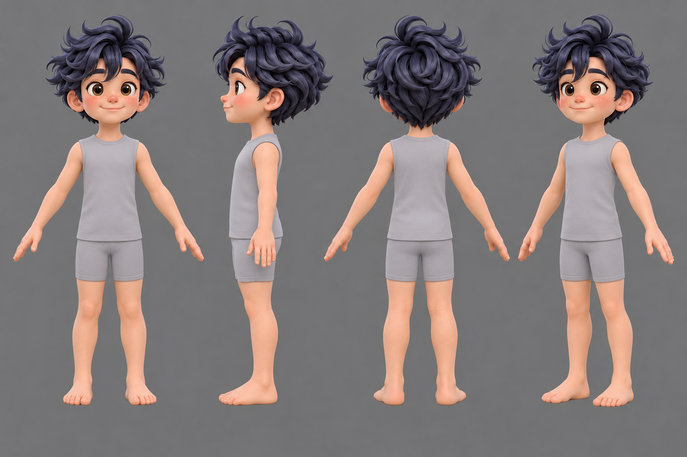
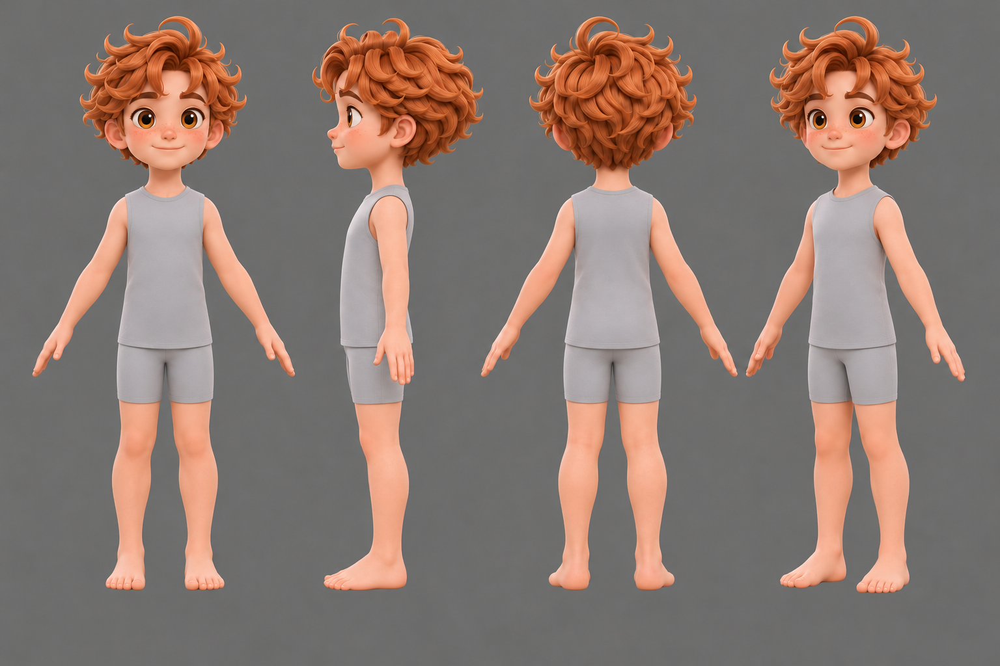
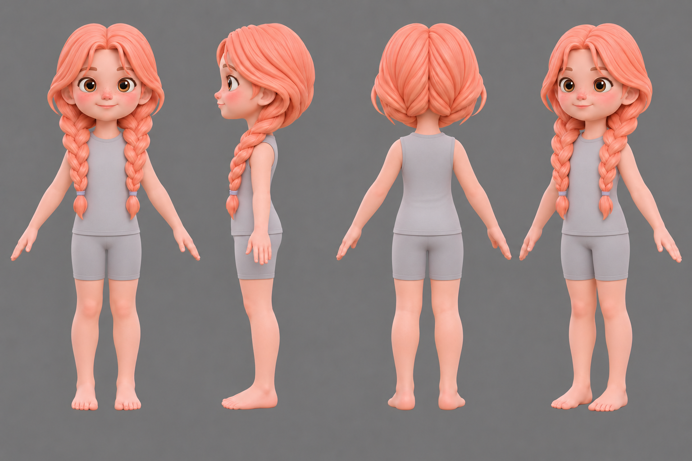
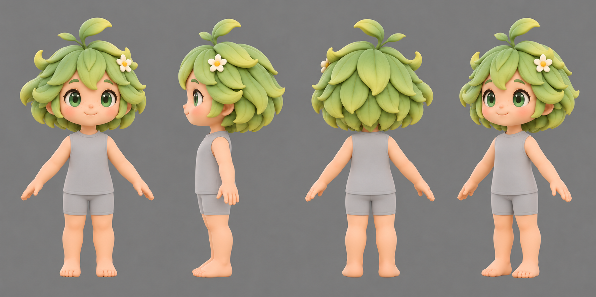
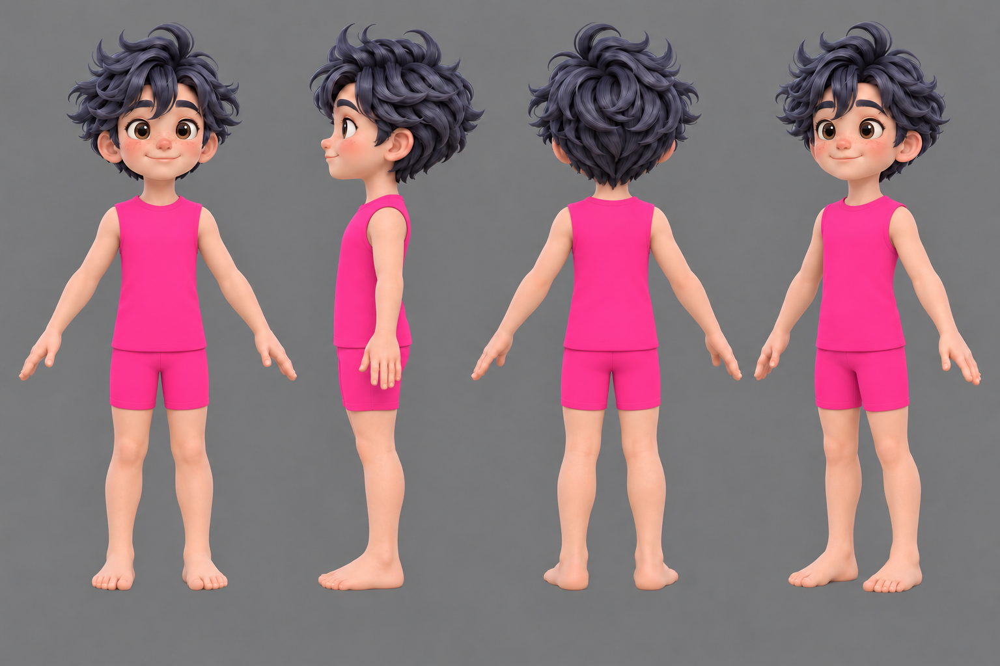
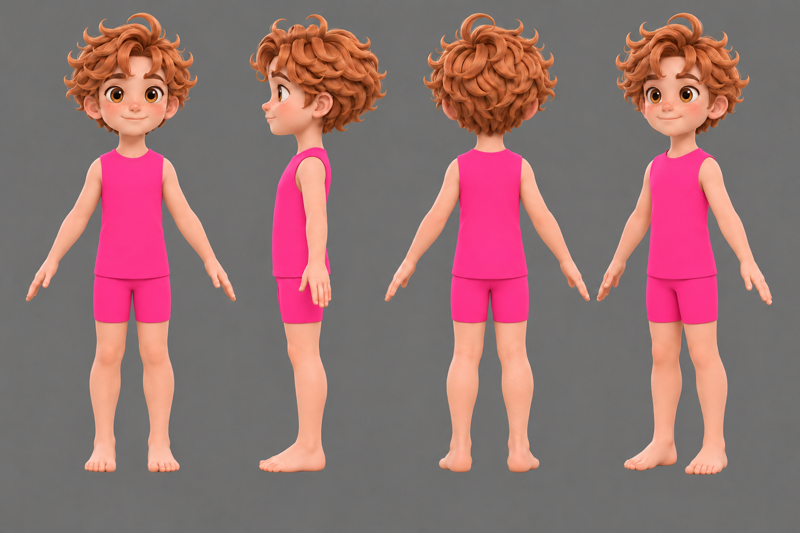
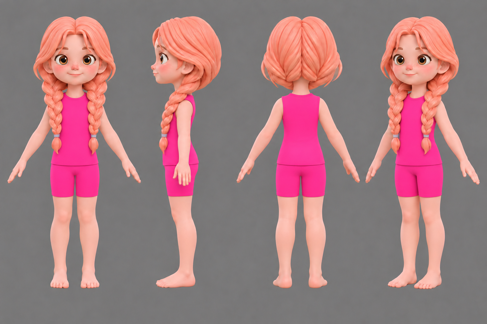
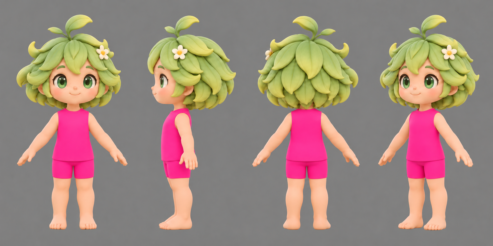
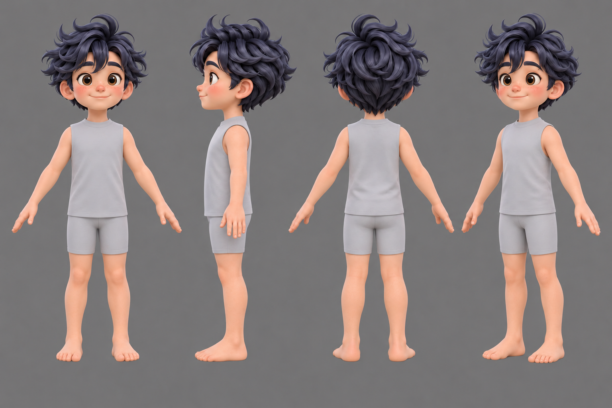

# Grey and bright pink swim-kit turnarounds

[Handoff and usage notes](README.md) · [Earlier T-shirt/shorts sheets](../friends-body-sheets-20261108/GALLERY.md)

## Light-grey swim kits

### Finn

[Open full image](grey/finn.png)

### Sol

[Open full image](grey/sol.png)

### Clara

[Open full image](grey/clara.png)

### Lumi

[Open full image](grey/lumi.png)

## Bright pink swim kits

### Finn

[Open full image](bright-pink/finn.png)

### Sol

[Open full image](bright-pink/sol.png)

### Clara

[Open full image](bright-pink/clara.png)

### Lumi

[Open full image](bright-pink/lumi.png)

## Additional Finn grey variant

Requested warm-peach skin base #E3A88B, with shaded rendering; grey clothing remains distinct. This is an additional option, not a replacement for previous source inputs.

