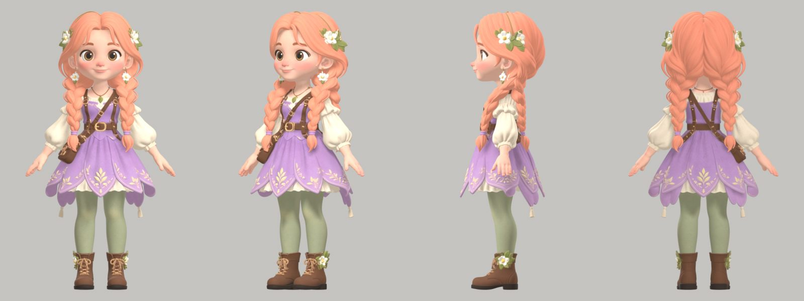
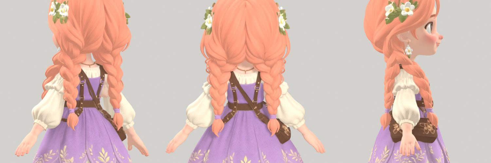
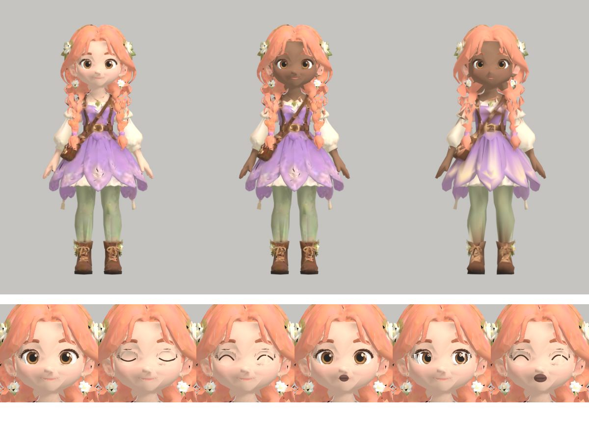
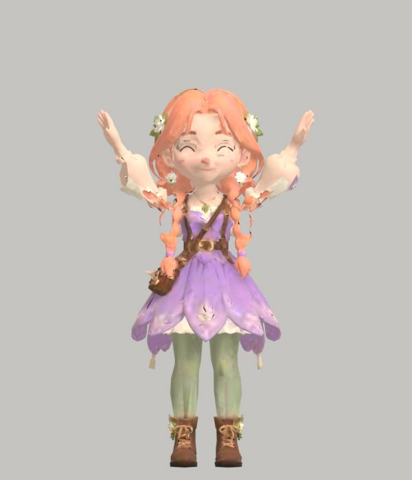
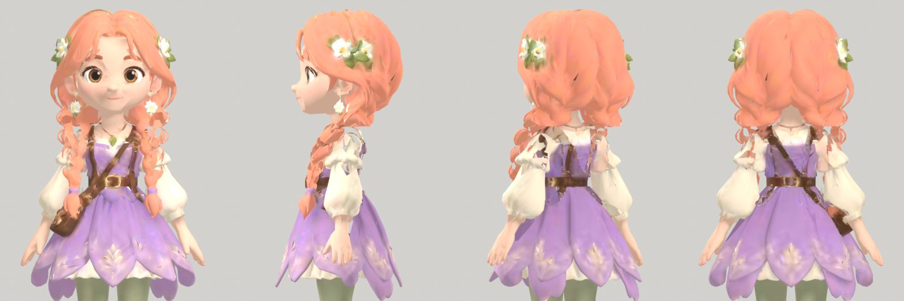
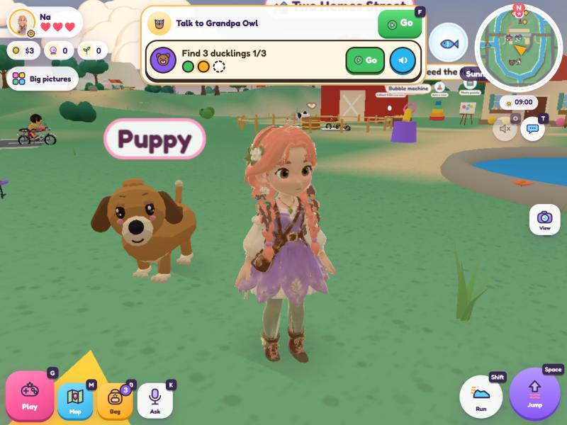
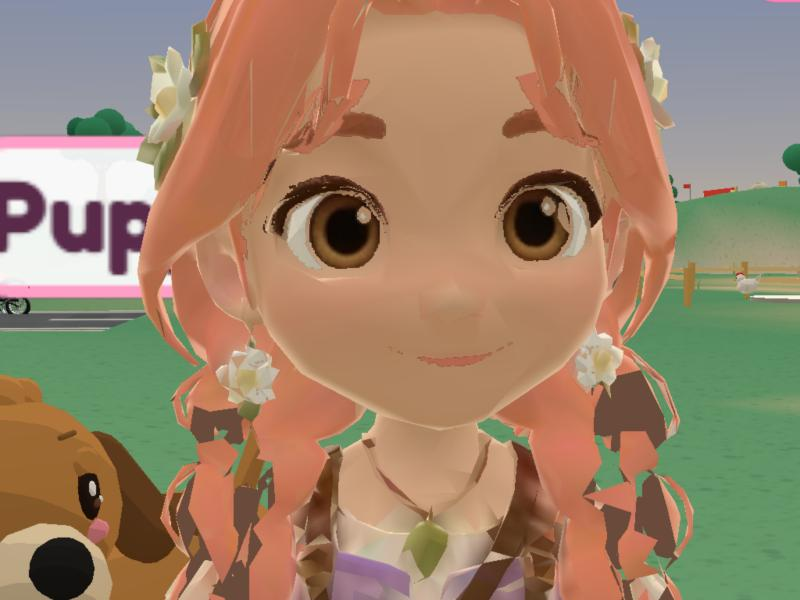
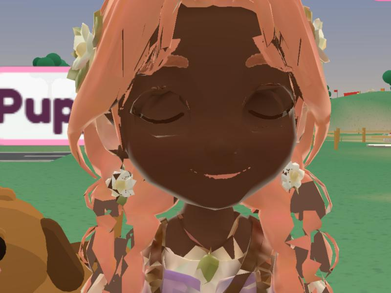

# Clara pilot — 7 November 2026 AEDT

The first paid Meshy job of the original 43-asset plan. One POST, through `tools/meshy/run_batch.py`, with the live
journal outside the repository. No retry, no other job.

## Account verification (before the POST)

- `MESHY_API_KEY` bound as a Windows user environment variable on the owner's PC (typed hidden by the owner; never in
  chat, source, a file or a command argument). The runner reads it from its own process environment.
- `GET /openapi/v1/balance` with that key: **3,049** credits (monthly 3,034 + permanent 15), monthly reset about
  7 Dec 2026. So the API uses the plan's credits on this account; no separate API purchase was needed.
- Private licence: the API has no per-task visibility field; the owner confirmed in chat that the account is on a paid
  plan with the Private licence.
- Pricing re-checked on docs.meshy.ai/en/api/pricing: Multi-Image to 3D, meshy-7.1, standard geometry, 2K textures =
  30 credits.
- Account record and journal: `D:\WorkSpace\meshy\private\` on the owner's PC (outside the repository, not committed).
  Run on Windows with `PYTHONUTF8=1` (the manifest holds Vietnamese text; Windows' default code page cannot read it).

## The job

| | |
|---|---|
| Task | `01a1b551-4e41-7544-a5da-564f88acc6f3` (multi-image-to-3d, meshy-7.1, front + left-side + back, image enhancement off, no pose) |
| Inputs | the three reviewed crops, hashes checked by the runner |
| Time | submitted 20:22, SUCCEEDED 20:24 AEDT |
| Charge | **30 credits** (balance 3,049 → 3,019) |
| Raw GLB | 56,560,796 bytes, sha256 `1fd03261…fe1fc9162`, kept outside the repository (`D:\WorkSpace\meshy\raw-models\A\clara.glb`) |
| Geometry | one mesh, 1,840,250 triangles; one 2048 × 2048 base colour (plus Meshy's detail maps) |

## Review of the raw model

Outfit, face, satchel, embroidered petal skirt, boots and leaf pendant match the reviewed sheet closely; the quality is
high. **One defect: four braids.** The reviewed back view shows the braids down her back while the front and side
views show them in front of the shoulders, and Meshy built both pairs:

**Before more paid jobs:** check every remaining sheet's front/side/back for this kind of disagreement (hair, bags,
straps, capes). It is not caught by the technical review, and each conflict costs a job.

## Fitting (tools/meshy/fit_people.py)

Recreated in the repository from the owner's local Clara test workflow, with the joint points in
`joints/clara.json` (marked on `tools/meshy/render_views.py`'s front render). It:

- reduces the model (high detail 22,000 triangles with one 768 px picture; light 8,000 triangles, colours in the corners,
  no picture), rebaking the colour onto clean UVs;
- removes the duplicate back braids (`trim_back_hair`, 1,299 / 523 triangles);
- makes the skin its own `skin-shade` part, so the game's skin tone applies (face, neck, forearms and hands; cream
  sleeves and collar stay cloth);
- gives the 11 joints the runtime copies, region weights, the arms at a 20° rest angle, and removes triangles that would
  stretch where Meshy fused a sleeve to the satchel;
- makes `face-<mood>` layers from her own painted eyes and mouth: smile, blink, half, happy, surprised, sad, lookL,
  lookR, excited.

Known flaws: a faint shadow of the open eyes shows through the closed-eye moods; the look-left/right irises are rough.

## Braid fix and in-game look (7 Nov 2026, later)

`trim_back_hair` now works in three steps: the back braids come off the full-detail model before the colour bake (so
the dress behind them is baked, not hair), the reduced model loses any hair-coloured surface behind the body between the
waist and the neck (wide enough to reach the locks lying on the sleeves) and any small loose pieces left there, and
cloth triangles behind the back that Meshy painted hair-coloured are repainted from the cloth around them. Texels the
bake misses are filled from their neighbours (this also removed dark slits on the skirt).

In the game (temporary local swap of models/clara*.glb plus the face-picture see-through change, both reverted, not
committed; the game paused and one frame drawn by its own renderer from a camera in front of her):

Visible up close: the reduced braids are blocky with a few strap-coloured patches, and the face layer's edge shows a
faint light rim along the jaw. Skin tone, blink, the cheer and walking all follow the game.

## Not integrated: the face decision

v1.08's tests (`tests/faces.mts`, `friendmodel` in `tests/checks/play.mts`) require each friend's face to be the
sculpted `face3d` mesh with 13 moods as shape keys (owner, 6 Nov 2026: "Animated-film 3D"), checked by ray-casting the
eye whites and measuring the mouth. The fitted pilot uses face pictures instead (the runtime still supports them, the
tests do not), so **models/clara.glb and models/clara-hd.glb are not replaced** on this branch. Owner choice:

1. **Transplant the game's sculpted face** (`tools/blender/lumi-face3d.py`: eyeballs, closing lids, brows, mouth) onto
   each Meshy head. Passes the existing tests and the 6 Nov decision; the faces become the game's style on Meshy heads,
   and each head needs the face sunk into it (real per-character modelling work).
2. **Keep Meshy's own painted faces** (the mood pictures above) and change the v1.08 runtime and tests to accept them
   for Meshy characters (the face pictures need see-through support in `js/friend-model.ts`). Keeps the Meshy look;
   changes the 6 Nov decision for these characters.

Other integration facts (fitted pilot packed with gltfpack 0.20, `-cc -kn -km`, outside the repository): light
**234 KB** (limit 500 KB; the current Clara is 143 KB), about 7,500 triangles shown (limit 12,000), three draws;
high detail **701 KB** (the current high-detail friends are 226-270 KB; no size limit is tested, but phone memory and
download time need checking).

`claraPilotAccepted` stays **false** in the account record until the owner accepts the pilot (braids, face path).

## Checks (owner's Windows PC, 7 Nov 2026)

- `tools/meshy/test_batch.py`: 10/10 offline runner tests pass; `check_readiness.py` passes except the account items it cannot see.
- `node tests/suite.mts --only emoji,preload,noemoji,arch,unit,names,bilingual,rules,types`: 8/9 pass. `unit`: 526 of 529 pass, 1 skipped, 2 fail only because `ffmpeg` is not installed on this PC (the voice delivery-encoder tests). First attempts failed for missing `tests/node_modules` and root `node_modules`; installed from the lock files.
- No browser or full suite run; the full release suite runs on GitHub.

## Round 3 (7 Nov 2026, evening): braids, original look, face, sleeves

Owner-approved extra spend, both outside the 990-credit plan, sent once each, never retried:
- **clara-r2** (30 credits, task `01a1b58a-d2db-7782-9703-ad4a47802716`): front + left-side views only (`job-specifications/01-clara-r2.json`; `run_batch.py` now accepts an owner-approved revision that sends a subset of the reviewed views). Result: two braids, as in the ChatGPT sheet.
- **Remesh** (5 credits, task `01a1b5b5-61a1-7570-984e-7d1ef26df9b5`, `tools/meshy/remesh_once.py`): Meshy rebuilt clara-r2 at 30,941 triangles. Hair, braids and sleeves match the original exactly (our own reduction had shredded them).
Balance 3,019 → 2,984.

Fitter changes (`joints/clara-remesh.json`): `keep_meshy_uvs` (Meshy's own picture and UVs, no rebake), `original_skin` (skin kept exactly as painted; no skin-tone part), face picture projected straight from the front (4 rays per pixel, bilinear), face layer as an even grid laid on the face (holes filled, smoothed, body pushed just behind it), closed lids filled from her own skin, soft rose open mouths, eye-socket smoothing.

**Open:** arms. With the arms rotated to a 20° rest angle the sleeve backs tear; without it the rest pose is clean (the runtime copies turns from each rest pose, so the model keeps its A-pose arms at rest). Raising the arms (cheer) still tears the sleeves and the sides of the dress: the region weights are too hard at the shoulders, and Blender's bone-heat weights fail on Meshy's separate shells (34k of 47k points unsolved). Next: Meshy Auto-Rigging (5 credits) for real skin weights, mapped onto the game's 11 joints.

## Lessons for the other 99 models

1. **The views must agree.** Check every sheet's front/side/back for the same hair, bags, straps and capes before paying; send only the agreeing views (a revision costs 30).
2. **Let Meshy reduce the mesh.** Remesh (5 credits, ~30k triangles) keeps hair and cloth whole; our own decimation shredded them. Build the light phone model from the remesh.
3. **Keep Meshy's own texture and UVs.** Rebaking loses detail and seams the face.
4. **Faces: one opaque face layer per mood, projected from the front**, lids painted from the character's own skin. The same code works for every person once the joints file is marked.
5. **Don't re-pose the arms**; the runtime handles a different rest pose.
6. **Skin weights need a real rig.** Region weights tear when arms lift; plan Meshy Auto-Rigging (5 credits per character) or proper weight painting before mass production.
7. Cost per person, done this way: 30 (model) + 5 (remesh) + 5 (rig) = **40 credits**, not 30.
