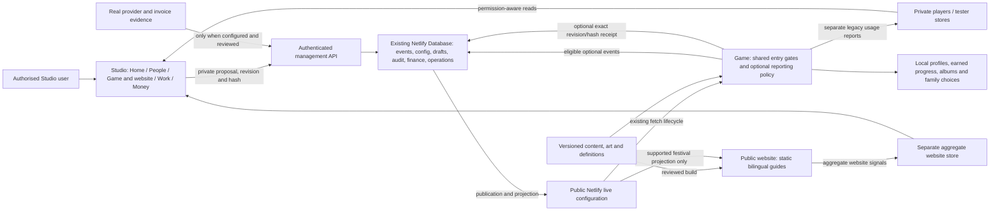

# What connects to what

No arrow merges a website visitor into a named child. No public export includes private profiles, credentials or provider balances. Studio's snapshot coordinates evidence; it does not replace these authorities.

## Thirteen domains

| Domain | Public/source → consumer → management evidence | Control and remaining boundary |
|---|---|---|
| Games/learning | `js/games/catalog.ts` / `js/content/activities.ts` → lazy loader/registry/frame → typed catalogue, event detail and usage | `content.itemAvailability[game:id]` at shared start; On still requires release/progress/implementation |
| Stories/family | `learn.ts`, tales catalogues and chapters → shelves/read/theatre → story detail | `story:id` Off at entry/theatre; private authored records remain outside public inventory |
| Quests/missions | adventure, chapter, job and family mission definitions → their runtime consumers → reviewed guides/source audit | No universal per-quest live editor; audit actual consumer before claiming a control |
| Rewards/economy | reward/unlock/shop definitions → actual progress/purchase logic → catalogue dependencies and audit | Item controls never reset earned progress or substitute payment/accounting evidence |
| Festivals/schedules | festcal/releases/festival visibility → game and supported public festival projection → Studio schedules/guide snapshots | Static art/game guides are separate from the real festival live consumer |
| World/transport | map/regions/places/roads/homes/vehicles → world rendering/interactions → source manifest | Definition/import evidence is not every placed instance or a working live world editor |
| Social/multiplayer | net/family/relay/online modules → invitations/session → permitted device/problem context | Parental network permission and bounded services; no inferred global family identity |
| Voice/media | shipped language manifests and public art/assets → player/canvas → coverage/recording audit | Twelve new guidance lines absent; private family media not exported; file presence is not listening review |
| Website/acquisition | versioned reviewed guides → `home/` build; aggregate events → website summaries | Static availability explanations, no automatic live item rewrite or child-level marketing attribution |
| People/devices | `players.ts` → `/api/hello` private stores; optional management events → SQL → scoped People | Installation ID plus local profile key/device day. Names require detail grant and consent; no name-based dedup |
| Quality/releases | tester reports, versioned changes and tests → attention/work/release evidence | Observed, fixed-in-code, deployed and verified are separate states; no deployment authority from a green badge |
| Services/operations | bounded jobs/provider adapters → durable runs/results/audit → Work/services | No arbitrary execution or fabricated provider readiness; only configured evidence counts |
| Finance | original-currency minor-unit records/FX/tax/budgets → preview/commit/version history → Money | Partial-source ledger, not complete profit/cash/billing evidence; payments not authorised |

## Field and graph contracts

The original detailed data dictionary, metrics and connections are preserved in the [foundation](../studio-management-foundation/HANDBOOK.md) and [connected registry](../studio-connected-concept-20261027/registry.json). New exact item fields are in [ITEM-FIELDS](../studio-control-recovery-20261029/ITEM-FIELDS.md); detailed reporting fields/API/grants/expiry are in [CONTRACT](../studio-functions-20261029/CONTRACT.md). The current graph-status map is GRAPH-STATUS.json; proposed graphs retain their original definitions instead of being counted as implemented.

## How a control reaches a device

1. Read current global baseline; save a private proposal with expected revision and server-built scope.
2. Review its exact saved revision/hash. Unsaved edits invalidate review.
3. Publish atomically into SQL/config/audit. A code deployment is a separate action.
4. Project the snapshot to public live configuration and read it back. A pending projection is not public availability.
5. A compatible online device fetches and persists the revision/hash; offline and old clients may wait or remain unsupported.
6. Optional reporting may send a receipt. Opted-out/Off devices can remain unconfirmed.
7. Inspect actual consumer evidence. Receipt means reported persistence, not that every feature stopped or an open activity was interrupted.

Filters affect reports only. Publication remains global. No cohort/device targeting is implemented by choosing a filtered report. Read failure means unavailable, never Off or zero. Failed/uncertain writes require a fresh read; visible edits remain available for copying.
