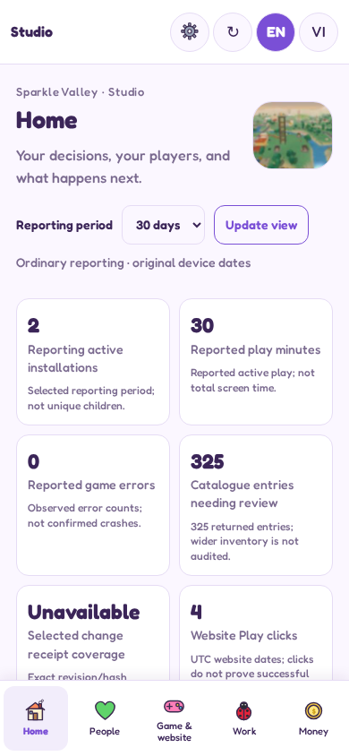
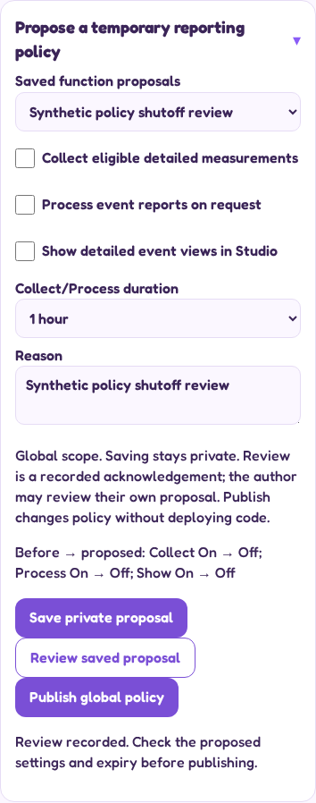
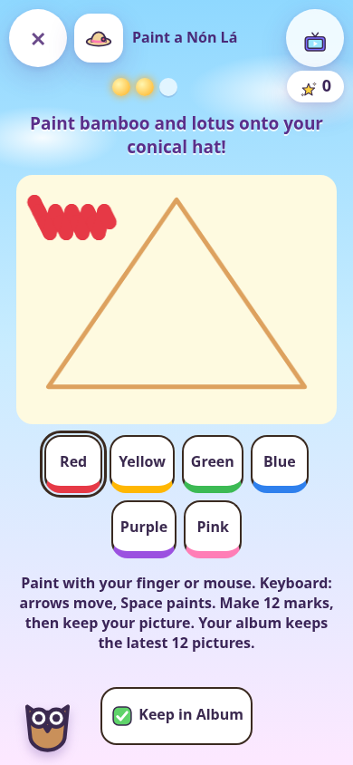
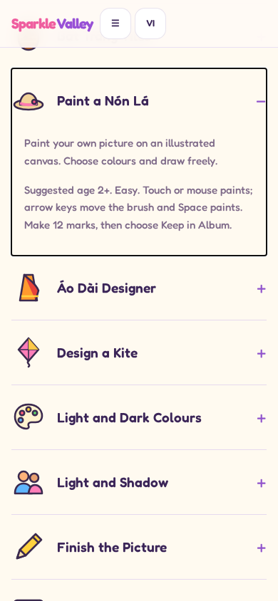

# View on an iPhone

These links open Markdown and PNG images directly. Actual screens use synthetic data and browser emulation. They are not physical-device validation or a production deployment.

## Actual combined Studio Home

[Full Home](screenshots/studio/en-390-today.png) · [People](screenshots/studio/en-390-people.png) · [Game catalogue](screenshots/studio/en-390-game.png) · [Work](screenshots/studio/en-390-work.png) · [Money](screenshots/studio/en-390-money.png)

## Actual policy editor

[Full Settings](screenshots/studio/en-390-functions.png) · [Configuration and receipts](screenshots/studio/en-390-function-delivery.png)

## Actual added art activity and website guide

These content screenshots retain B's recorded source provenance; the same content files are included in the combined branch and have fresh combined functional checks. They are not relabelled as new physical captures.

## Original broader concept

[Master concept pictures](../studio-revamp-master-20261027/VISUALS.md) and [complete master design](../studio-revamp-master-20261027/MASTER-DESIGN.md) preserve the intended full experience. Those concept screens contain fictional values and include functions still pending; they must not be confused with the actual screens above.
