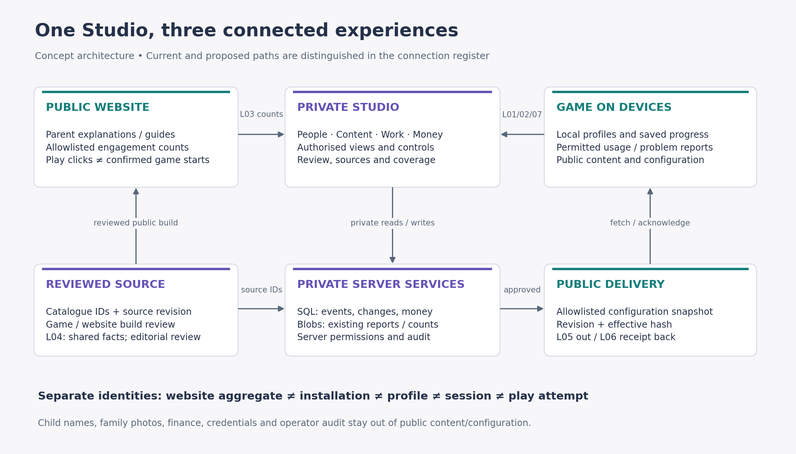
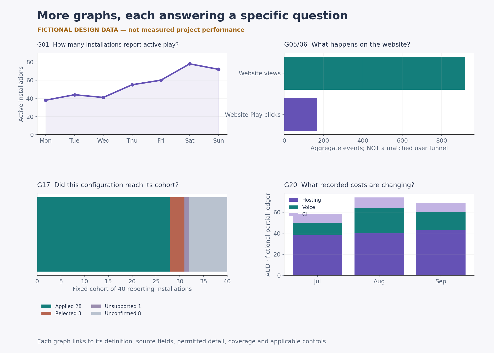
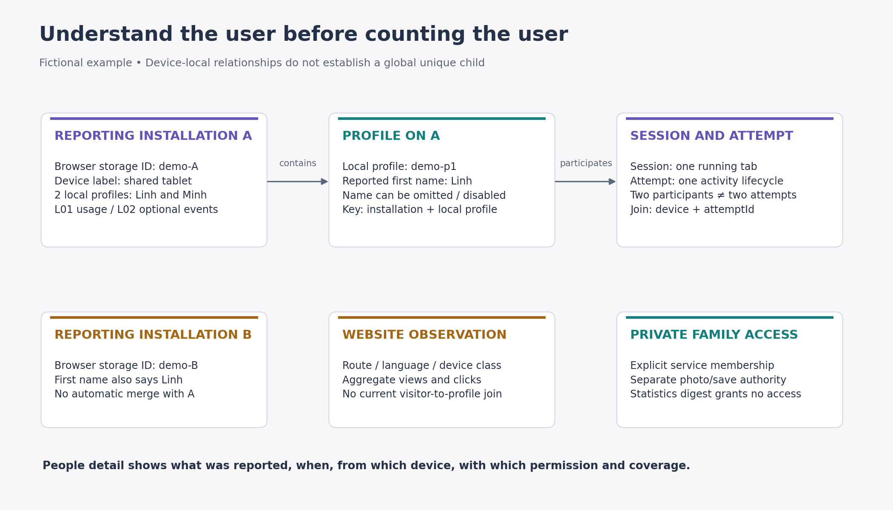
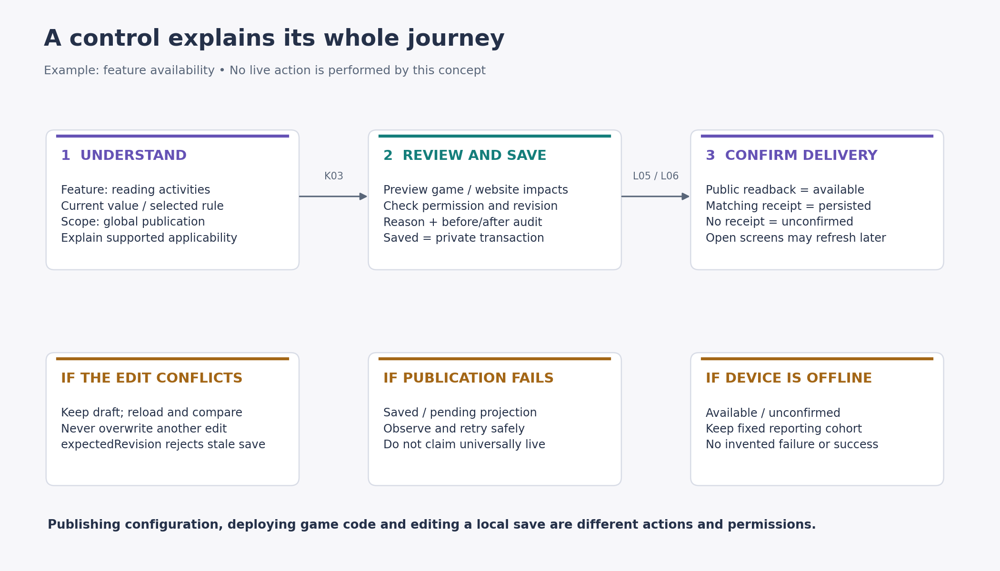
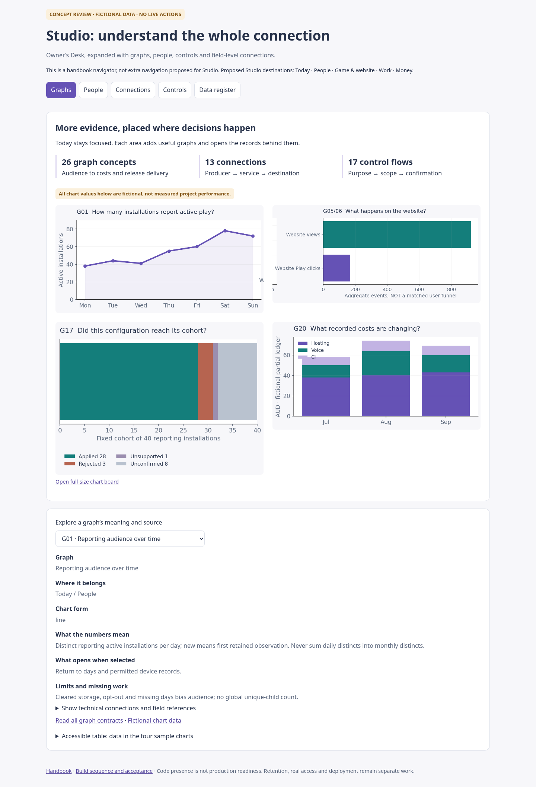

# Visual walkthrough

These are original concept illustrations and fictional data, not captures of a rebuilt production Studio. The connected handbook is an explanation/review tool; its navigation is not another proposed layer of Studio menus.

## Website, Studio and game



[Full-size PNG](images/system.png) · [Scalable SVG](images/system.svg) · [Connection contracts](CONNECTIONS.md)

## Graphs that lead to evidence



[Full-size PNG](images/graphs.png) · [Scalable SVG](images/graphs.svg) · [All 26 graph definitions](GRAPHS.md)

The audience line counts reporting installations, not globally unique children. Website clicks/views remain separate event totals. Configuration delivery uses a fixed cohort with unconfirmed devices visible. Costs explicitly describe a fictional partial ledger. All underlying illustration values are in [synthetic-data.json](synthetic-data.json); the offline review also includes a readable table.

## User and device relationships



[Full-size PNG](images/identity.png) · [Scalable SVG](images/identity.svg) · [Detailed People screen](SCREENS.md)

## Understand a control before using it



[Full-size PNG](images/control.png) · [Scalable SVG](images/control.svg) · [17 control contracts](CONTROLS.md)

## Rendered offline handbook

The screenshots below demonstrate the handbook and field inspector. The application redesign remains proposed.

| Section | Desktop | Tablet | Phone |
|---|---|---|---|
| Graphs | [Open](screenshots/graphs-desktop.png) | [Open](screenshots/graphs-tablet.png) | [Open](screenshots/graphs-phone.png) |
| People | [Open](screenshots/people-desktop.png) | [Open](screenshots/people-tablet.png) | [Open](screenshots/people-phone.png) |
| Connections | [Open](screenshots/connections-desktop.png) | [Open](screenshots/connections-tablet.png) | [Open](screenshots/connections-phone.png) |
| Controls | [Open](screenshots/controls-desktop.png) | [Open](screenshots/controls-tablet.png) | [Open](screenshots/controls-phone.png) |
| Data register | [Open](screenshots/data-desktop.png) | [Open](screenshots/data-tablet.png) | [Open](screenshots/data-phone.png) |



Browser findings are recorded in [browser-validation.json](browser-validation.json). A passed handbook review is not an application, live-database or physical-device test.

## Reproduce

From the repository root, run these sequentially (do not run another local suite/browser test at the same time):

```sh
python docs/studio-connected-concept-20261027/tools/build.py
MPLCONFIGDIR=/tmp/tpn-concept-mpl python docs/studio-connected-concept-20261027/tools/visuals.py
PLAYWRIGHT_BROWSERS_PATH=/workspace/.cache/ms-playwright node docs/studio-connected-concept-20261027/tools/review.mjs
python docs/studio-connected-concept-20261027/tools/validate.py
```

The plotting script needs Matplotlib; the browser script uses the repository’s installed test harness/browser. All registry JSON is embedded in `review.html`; this page makes no application or external HTTP requests. Extract the whole folder before opening it offline so relative images/documents remain available. GitHub shows the Markdown and images directly, but does not execute the HTML prototype.
