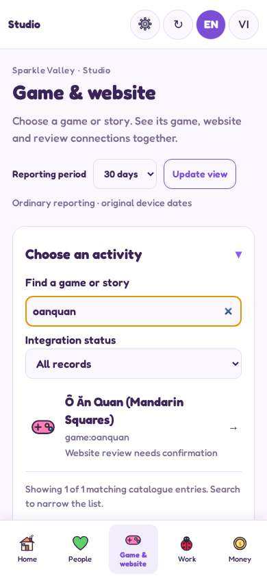
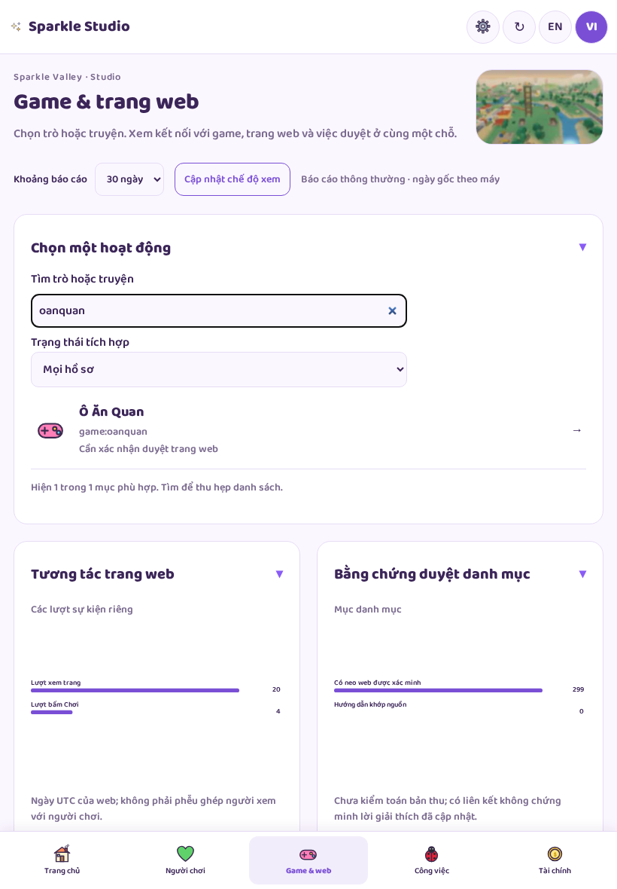
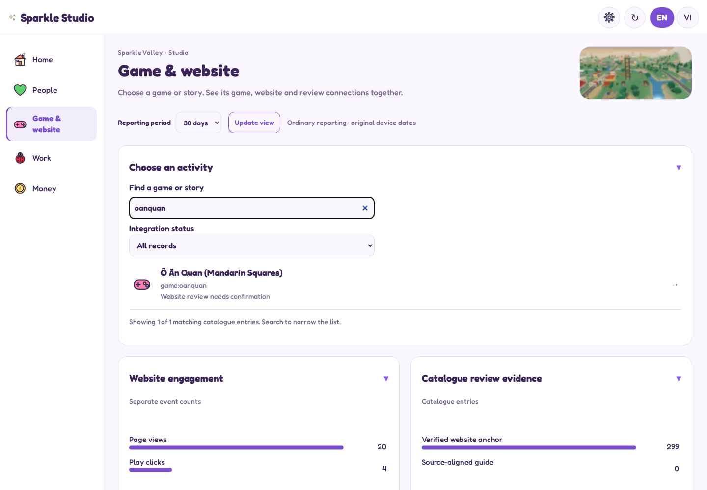
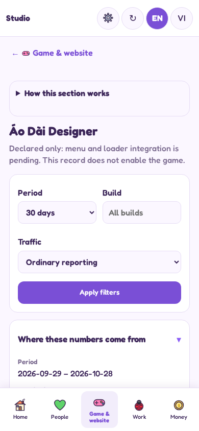
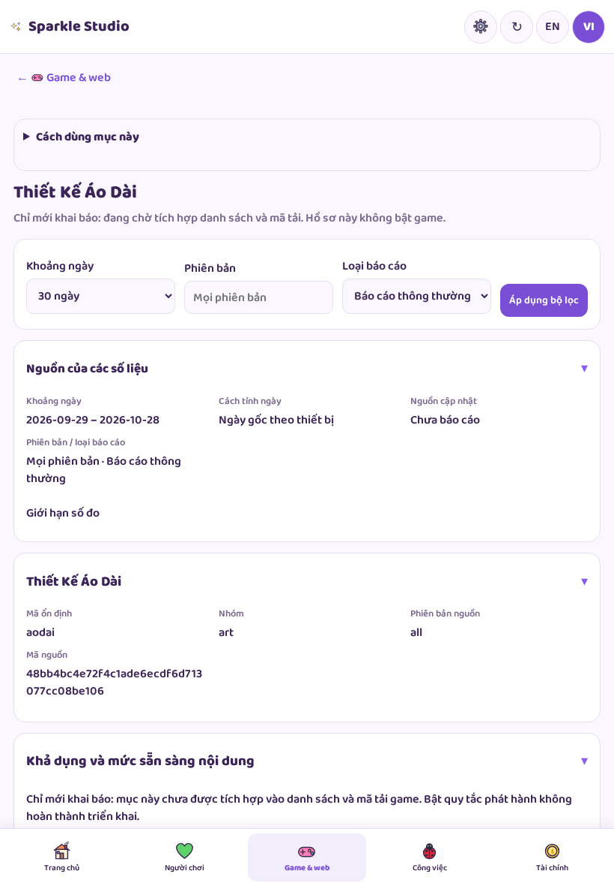
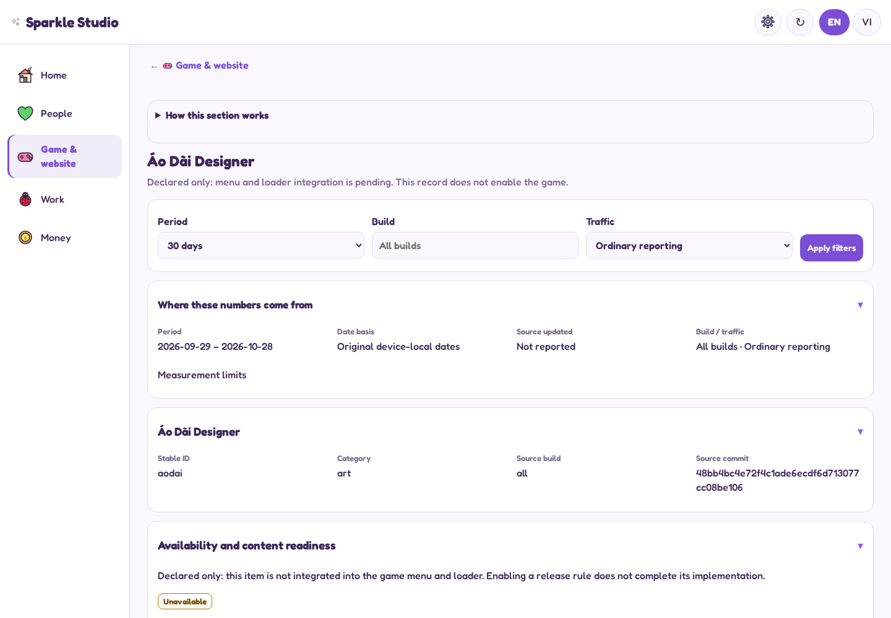
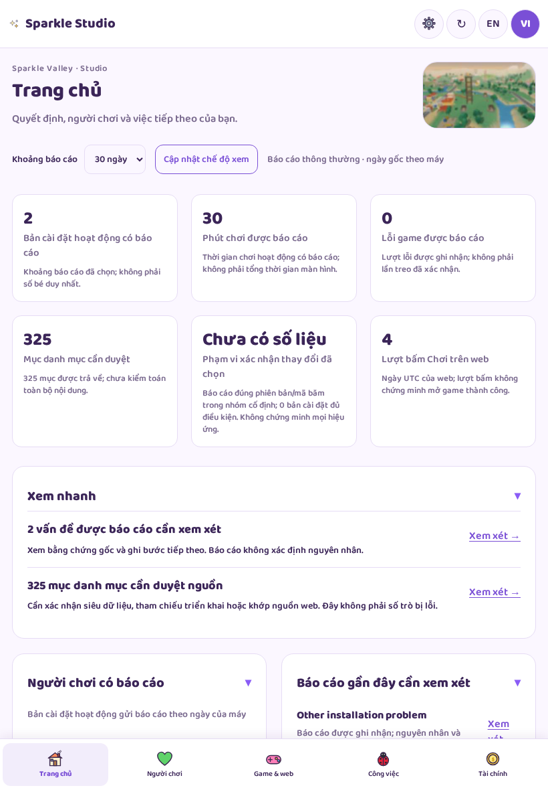
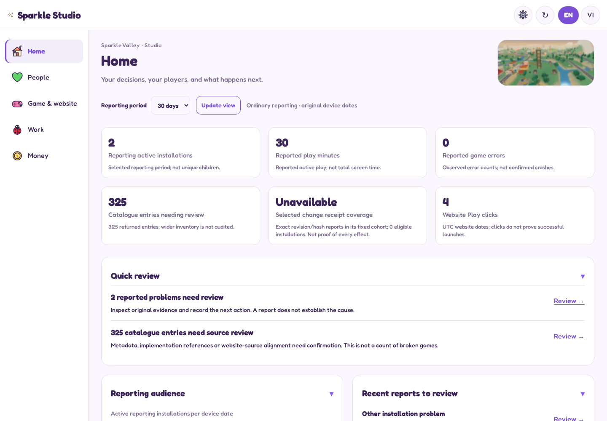

# Actual Studio continuation screenshots

Actual application code with synthetic reporting records; browser emulation, not production or physical-device evidence. Tap pictures to enlarge. These are PNGs rather than an HTML code viewer.

## Game and website catalogue

### EN · 390px

[Full page](screenshots/en-390-game.png)

### VI · 820px

[Full page](screenshots/vi-820-game.png)

### EN · 1440px

[Full page](screenshots/en-1440-game.png)

## Pending integration detail

### EN · 390px

[Full page](screenshots/en-390-declared.png)

### VI · 820px

[Full page](screenshots/vi-820-declared.png)

### EN · 1440px

[Full page](screenshots/en-1440-declared.png)

## Home snapshot

### EN · 390px

[Full page](screenshots/en-390-today.png)

### VI · 820px

[Full page](screenshots/vi-820-today.png)

### EN · 1440px

[Full page](screenshots/en-1440-today.png)
