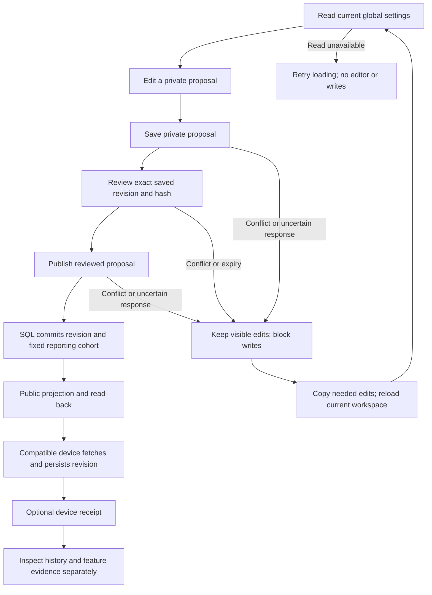

# From a proposal to a confirmed result

The same sequence applies to an item or the detailed reporting policy. All changes are global. Choosing an activity period or device report does not narrow publication scope.

## Normal work

1. Open the item or Settings → Functions & resource use. Inspect the current setting and its scope.
2. Enter a reason and Save. This creates a private proposal; the game/public snapshot does not change.
3. Review the exact saved proposal. Changing a field means Save and Review are required again.
4. Publish. This writes a global configuration revision through the existing transactional workflow. It does not deploy application code.
5. If projection is pending, inspect configuration history. Retry pending projection through its existing permission-gated tool; do not create another proposal merely because delivery is pending.
6. Inspect device receipts. A missing receipt means unconfirmed, including devices that are offline, opted out or stopped reporting. A receipt confirms self-reported persistence of a revision/hash, not the effect of every feature.

## Failure recovery

| What happened | Meaning | What the user does |
|---|---|---|
| Initial read failed | No current setting is confirmed | Check sign-in/source and use Retry loading. No editor is shown |
| Database configured but current settings unreadable | Unknown is not Off or a numeric zero | Reload after restoring access; editing remains unavailable |
| `draft_baseline_conflict` / `config_revision_conflict` | Another publication changed the configuration this proposal was based on | Copy needed visible edits; reload current settings; create a new proposal against the latest baseline |
| `draft_revision_conflict` / `draft_already_published` | Another session updated or published this proposal | Copy needed edits; reload and inspect the latest saved proposal/history |
| Policy expired / duration out of range | The reviewed reporting expiry is no longer valid | Reload; save a policy with a fresh valid duration; review again |
| Permission or sign-in lost | Current access does not confirm the action | Preserve edits, restore access and reload |
| Timeout, dropped response or unknown failure | The request may have reached the server; success and rollback are both unconfirmed | Preserve edits; reload; inspect proposal and configuration history before retrying |
| Public projection pending | The configuration was committed but public delivery is not confirmed | Inspect history and use its existing projection retry; no second Publish |

After any request failure in these two editors, all write buttons remain blocked until the workspace reloads. Inputs stay visible so the user can copy them. Picking another draft does not unlock writes. Reload intentionally replaces the workspace with server evidence; unsaved browser edits are not silently rebased or persisted elsewhere.

## Grants and privacy

Reading the workspaces and configuration evidence requires `management.read`. Creating, reviewing and publishing these content proposals also requires `management.configure` and `edit`, enforced by the server. Device detail remains separately gated by `management.deviceDetail`; linking to configuration history adds no grant and exposes no new names or device identifiers. No receipt status is fabricated by the item editor.

The advanced JSON editor is a separate existing path; this slice applies recovery locking to the two contextual editors only. Its server revision/hash checks still apply. A future shared recovery pass must cover that editor and attention/finance operations without treating idempotency or response loss as proof of failure.

## Evidence before advanced editing

Configuration changes presents the latest revision receipt graph and history first. The existing advanced JSON editor remains below this evidence for authorised users. Its Save/Review/Publish behaviour and server checks are unchanged. No content, grant or deployment action is hidden by moving the form.
