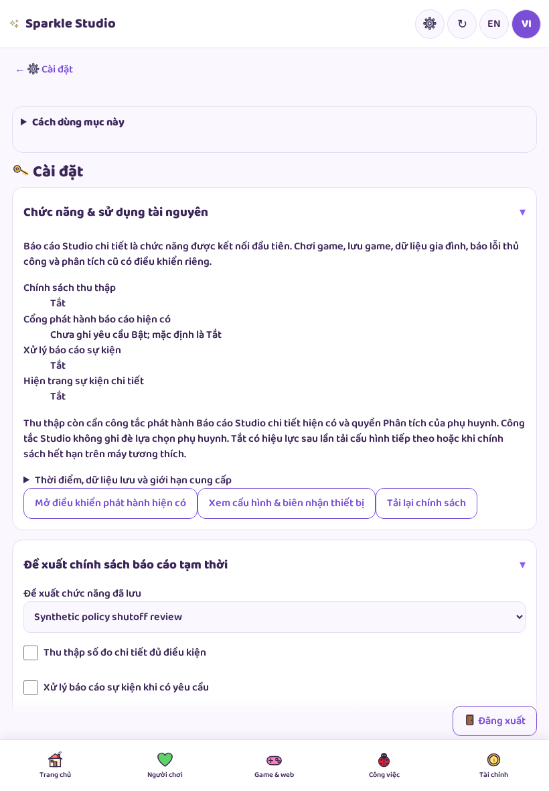
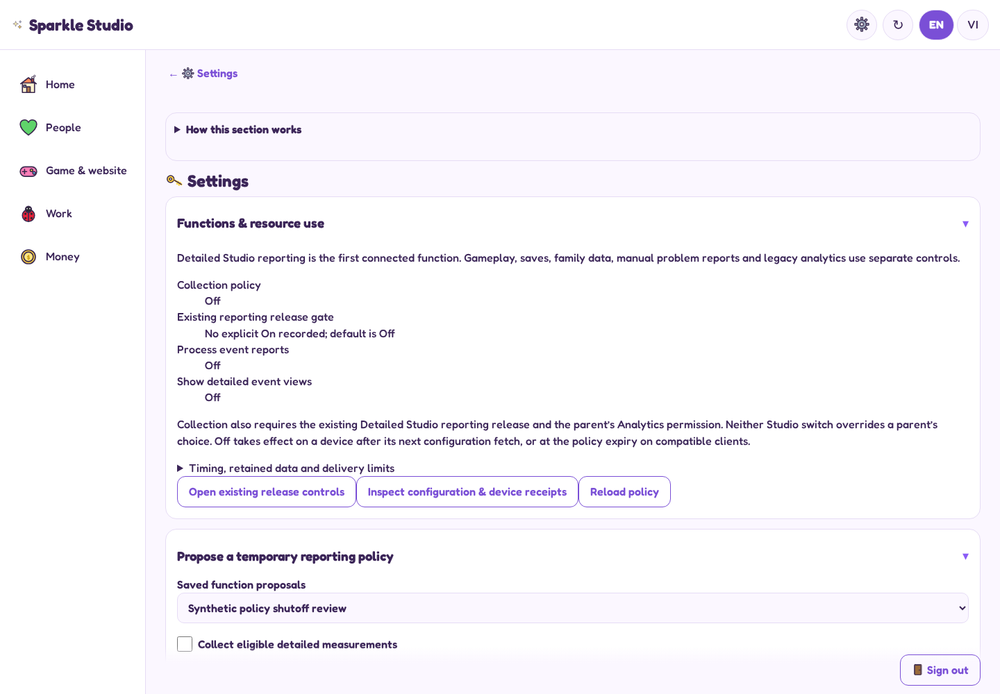

# Actual review screens

Synthetic accounts and policy, actual signed-in Studio. Browser emulation; no physical-device claim. Images are screenshots, not concept art. Phone/tablet pages scroll; a single viewport shows only part of a form.

## Phone policy editor

[Full Settings page](screenshots/en-390-functions.png) · [Configuration and receipt history](screenshots/en-390-function-delivery.png)

## Tablet settings

## Desktop settings

The six `*-control-recovery.png` images are isolated editor fixtures with injected failure scenarios, not production outages. See browser-validation.json for assertions and exact source hashes.
