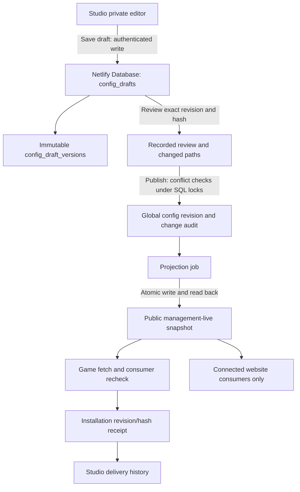

# Private configuration drafts: continuation

29 October 2026 AEDT. Working branch `review/studio-finance-20261027`. No production deployment, version change, main merge or live database migration.

This slice implements the private draft/review mechanism required by B07 in the [master build steps](../studio-revamp-master-20261027/BUILD-STEPS.md). It replaces the advanced configuration editor's immediate-save action with three explicit stages. It does not complete the contextual item workspace or the full Studio revamp.

1. **Save private draft:** persist a proposal and its immutable revision history in the management PostgreSQL database. Game settings remain unchanged.
2. **Review saved draft:** record the reviewer, exact proposed hash, baseline and changed rule/content paths. Show the normalised proposal in the editor. This acknowledgement may be performed by the author; it is not independent approval by a second person.
3. **Publish reviewed draft globally:** check the saved draft revision/hash and current global configuration revision/hash again, then atomically create the public configuration revision, immutable history, change record, audit and projection job, and mark the draft published. Projection is attempted afterwards. A pending result means delivery is not confirmed.

The same valley artwork, bundled fonts and Studio components remain in use. The interface and explanations are English/Vietnamese. Drafts can be reopened after leaving the page or reloading Studio. Editing requires saving and reviewing again. Published drafts are immutable; start a new proposal for another change.

[Field/API/storage contract](CONTRACT.md) · [Validation and limitations](VALIDATION.md) · [Actual screen gallery](VISUALS.md) · [Next-chat instructions](NEXT-CHAT.md).

## What connects to what

There is no game fetch, new event collection, polling or projection when saving or reviewing a draft. Publishing uses the existing configuration delivery mechanism. This cannot immediately change an offline game or guarantee an already-open activity closes. A receipt reports persistence of the snapshot, not proof that every individual control affected a screen. The website is affected only where it actually consumes the relevant settings; static website content still requires its own reviewed build. No draft operation deploys code, modifies children's saves or makes a declared-only game playable.

## Remaining work

- Contextual per-item editing: plain-language fields, before/after values, exact game entry and website consumer links, dependencies and impact rather than a JSON-first workflow.
- Optional-function Collect / Process / Show controls and verified consumers, costs, budgets and parent-choice precedence.
- Integration and playability review for the 26 declared-only game records; broader 104-rule consumer evidence and all-domain inventory completeness.
- Remaining graphs, marketing, Work/services and Money details from the master plan.
- Exact-source exhaustive GitHub results, website consistency review, physical-device checks, existing Netlify Database binding/grants, retention/deletion/restore and a separately authorised release.

The existing direct `POST management/config` integration remains compatible and still publishes immediately. The new editor uses draft endpoints. Other legacy content/release editors are not silently converted into private drafts in this slice.
