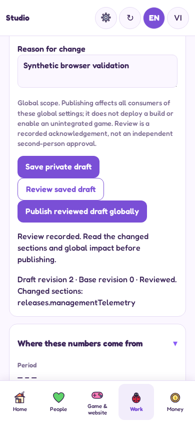
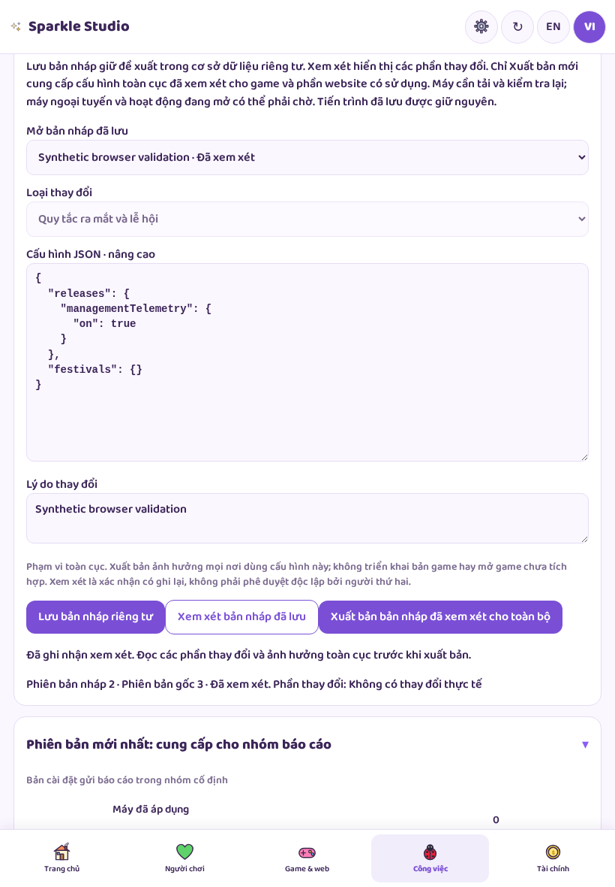
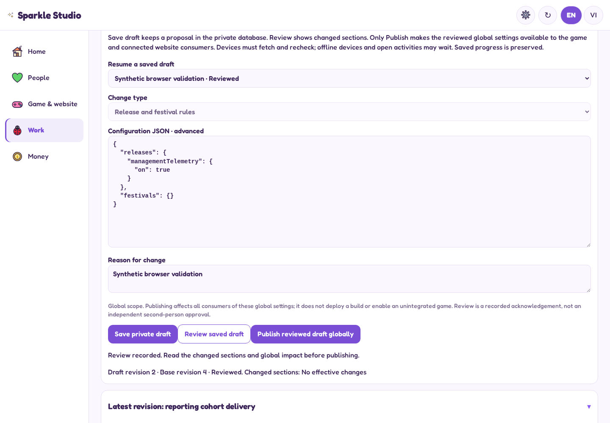

# Actual private draft review screens

Synthetic configuration and synthetic accounts only. These are actual Studio browser captures, not future-design concepts. Browser-emulated sizes do not prove physical-device behaviour. The advanced editor is an interim technical surface; the planned plain-language per-item workspace remains pending.

## Phone · English

[Full page](screenshots/en-390-draft-review.png)

## Tablet · Vietnamese

[Full page](screenshots/vi-820-draft-review.png)

## Desktop · English

[Full page](screenshots/en-1440-draft-review.png)

The capture is before Publish. A saved draft does not change the game; the separate Publish action affects all actual consumers of the global configuration. [Full contract](CONTRACT.md).
