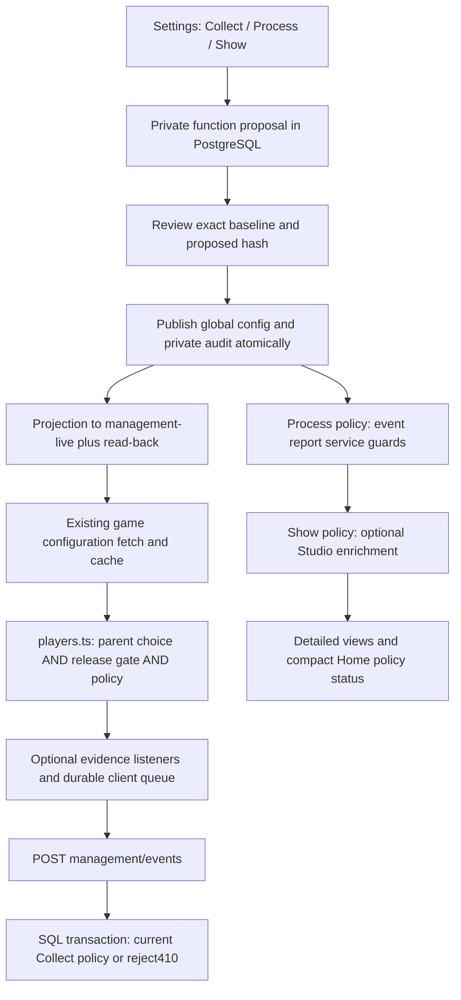

# Detailed reporting policy: fields and connections

## Data contract

The public snapshot carries one optional content section, reportingPolicy. It contains no actor, reason, child name, device target, credentials, role membership or provider data.

| Field | Type / bounds | Meaning and consumer |
|---|---|---|
| schemaVersion | Literal integer1 | Shared pure parser js/core/reporting-policy.ts; unsupported versions fail closed |
| collect | Boolean | Additional restriction on existing js/players.ts management eligibility; server ingestion also checks it |
| process | Boolean | Guards transactional attemptSummary/eventSummary; applies to new on-demand event analysis |
| show | Boolean | Guards optional event enrichment in authenticated management HTTP views; does not change collection |
| expiresAt | UTC ISO timestamp with Z, or null | Required when Collect or Process is On. New/changed policies must expire in the future within24hours of the write. Null is allowed only when both are Off |

The policy defaults to legacy compatibility only when absent. Malformed, null, scalar, unsupported or expired explicit policies never re-enable optional reporting. Invalid policies disable all three values. Expired valid policies disable Collect/Process and retain Show. Existing stored configuration is preserved through unrelated item edits; editing the policy requires a fresh valid expiry. Resetting/removing this section through the advanced editor restores legacy behaviour; the new panel provides no misleading reset-to-Off action.

New/changed policy budgets are checked by every revisioned configuration writer and draft saver, not only the new form. Review/publication of an expired function-scoped proposal fails; there is no automatic rebase or renewal. New private proposals and each public revision use the existing exact baseline/draft revision/hash checks and immutable history.

## API and private metadata

| Route | Grant / input | Result |
|---|---|---|
| GET management/functions | management.read | Registry, scoped policy/current state, redacted existing-release fields, fixed current queue/batch ceilings and source limitations |
| POST management/functions/draft | management.configure plus existing content-edit grant | Body: id?, expectedRevision, baseRevision, policy, reason. Server constructs a content proposal against the winning baseline |
| GET management/drafts/:id | Existing configure plus matching content-edit grant | Resume private function proposal |
| POST management/drafts/:id/review | Exact expectedRevision/effectiveHash | Record acknowledgement of the exact proposal; author may review their own proposal |
| POST management/drafts/:id/publish | Exact expectedRevision/effectiveHash | Atomically create global config/change/audit/projection job and mark proposal published; projection/read-back afterwards |

Function proposal context is itemKey=function:managementTelemetry. Another item or the generic editor cannot overwrite it. No arbitrary scope/cohort/family/function ID may be supplied. Other unknown function routes fail closed. Read-only function users receive no private proposals or device targets. Missing SQL/current configuration yields unknown and disabled editing, not a fabricated Off/healthy state. Private actor/reason/history stay in SQL and are not projected publicly.

Existing generic configuration routes remain compatible. Adding the function context does not turn an advanced Save into a private operation. See the [base draft contract](../studio-drafts-20261029/CONTRACT.md).

## Exact connections

1. Source: Studio form uses policy fields only; saved operator text remains private. Save changes no public producer.
2. Authority: public configuration revision in SQL is authoritative for server enforcement. An Off can protect ingestion immediately after the publication transaction even while public projection is pending. Devices remain pending/unconfirmed until they fetch; no new polling is introduced.
3. Client: js/custom.ts merges the public section and calls the shared parser. js/players.ts combines policy with parent countPlayers, eligible site/tab and featureOn(managementTelemetry,false). Parent Analytics Off wins. One expiry timer is armed only for an eligible active client, and eligibility is checked again before recording/uploading. A new policy/revision recreates a stopped client safely. Client expiry follows the device clock/timer; server expiry remains authoritative for acceptance when an offline or skewed client resumes.
4. Queue: js/management-telemetry.ts keeps existing event identities and acknowledgement semantics. Disable/expiry clears only sv2_management_out and sv2_management_bot_out through the existing lifecycle. Saves, sv2_hello_out, family state and manually filed report outboxes remain untouched. In-flight optional fetches receive an AbortSignal; cancellation cannot recall a server-accepted request.
5. Server: makeManagement keeps origin/body/rate-limit validation. ingestEvents checks current policy inside its persistence transaction before storing events. No event row is accepted when Off/expired;410 instructs the new client to discard its optional queue and stop retries until a new policy/client lifecycle. Requests already in flight can have read the earlier policy; no global ingestion lock or unbounded background work is added.
6. Processing: attemptSummary and eventSummary refuse new calculations when Process Off/expired, even for internal service callers. In-flight calculations may finish. There is no new scheduler, backlog drain or precomputed aggregate cache. Process On permits analysis of retained rows even with Collect Off.
7. Visibility: management HTTP only adds optional event detail when Process and Show permit it. Hiding a view naturally avoids its on-demand query, but does not disable the configured processor or uploads. Legacy source summaries and financial denominators remain separate. Failed policy reads preserve the legacy view and label optional policy unavailable.
8. Delivery: existing public revision/hash receipts remain consent/collection gated on the client. Server receipt validation is not disabled by Collect Off. Receipt persistence is separate from actual collector/processor effects.
9. Website: no website consumer is added. Static guides and website analytics stay in workstream B's ownership and retain their separate source/review contracts.

## Existing resource bounds and remaining measurements

Client batch: at most50events/64,000bytes. Queue: at most5,000events/1,000,000bytes, whole-attempt eviction,30day expiry. Receipts: at most100retained rows inside the existing queue. The existing endpoint guard allows120requests/IP per10minutes. These ceilings are inherited, not newly approved billing or performance budgets. The new pure policy source is1557bytes of TypeScript before stripping; actual bundle/HTTP/compression and physical-device costs require measurement. It adds a shared policy module and at most one eligible expiry timer, not a per-frame callback or configuration poll.

Accepted SQL records are retained under the existing lifecycle; no new retention/deletion job is installed. Current limits do not establish provider capacity, account cost, real Netlify access, physical-device battery impact or zero overhead. Those remain release/operations gates, using the owner's existing Netlify Database rather than provisioning another provider.
