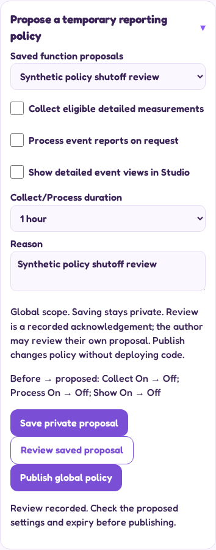
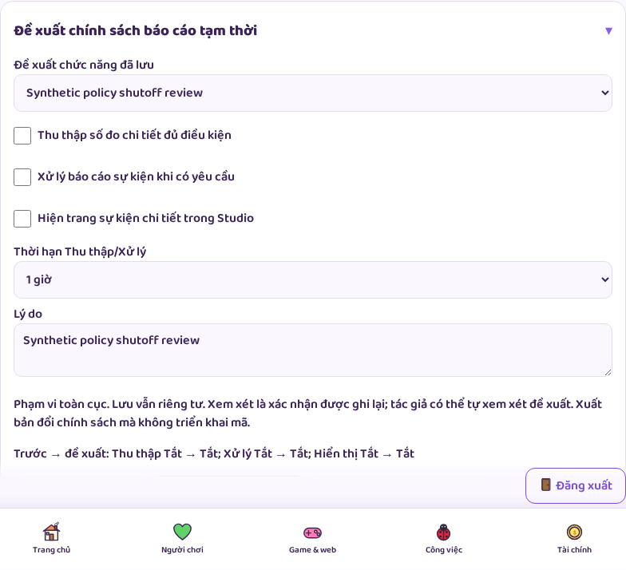
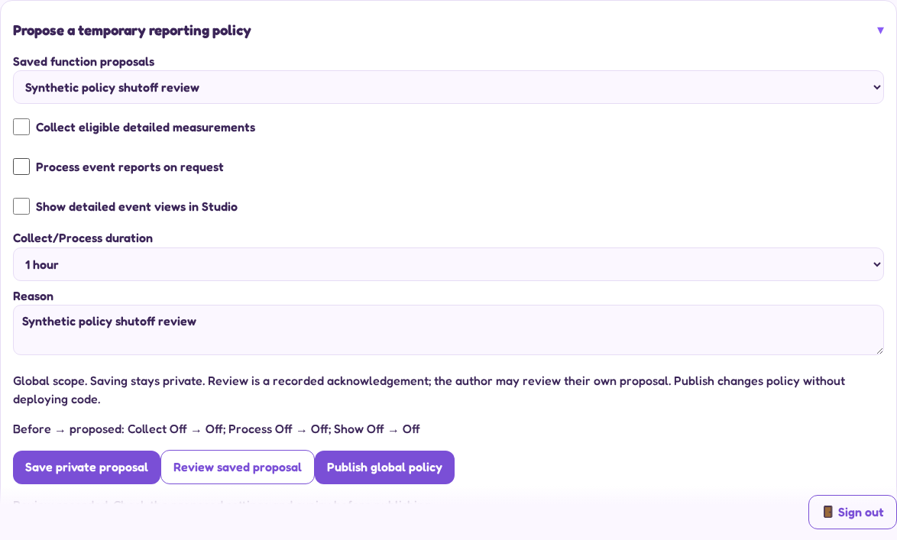

# Actual Studio function controls

Synthetic policy and accounts; actual authenticated UI and routes. Browser emulation is not a physical-device test. These screens control only detailed Studio reporting, not every analytics or game function.

## Phone: plain-language policy editor

[Full Settings page](screenshots/functions/en-390-functions.png)

## Tablet: Vietnamese

[Full Settings page](screenshots/functions/vi-820-functions.png)

## Desktop

[Full Settings page](screenshots/functions/en-1440-functions.png)

Save is private; Review records the exact proposal; Publish makes it global. Timing, retained-data and delivery details expand separately. Toggle labels use the shared44px minimum; no new interface style or external artwork is introduced.
