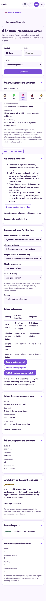
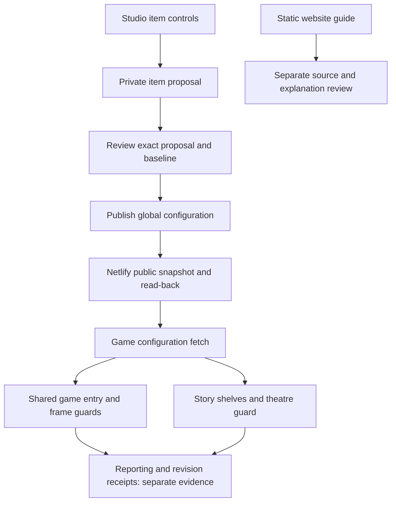

# Studio item workspaces and two-chat continuation

29 October 2026 AEDT. Plain-language item controls and shared launch boundaries are implemented on the review branch; whole-project work remains in progress.

- [Two-chat ownership and all remaining work](TWO-CHAT-PLAN.md)
- [Copyable prompt for the second chat](SECOND-CHAT-PROMPT.md)
- [Actual implementation, tests and pending checks](STATUS.md)
- [Master Studio concept and complete build sequence](../studio-revamp-master-20261027/README.md)
- [Existing draft/review/publication contract](../studio-drafts-20261029/CONTRACT.md)

## Actual phone workspace

Synthetic example data, actual Studio UI, browser emulation. This is an interim implementation screenshot, not a physical iPhone check or proof of full-game completion.

[Tablet Vietnamese](screenshots/vi-820-item-review.png) · [Desktop English](screenshots/en-1440-item-review.png)

## Control connections

Off preserves progress and blocks new starts once the device has fetched the setting. Already-open activity may finish; offline devices retain their cached settings. Simple-screen Hide changes listing only. On does not integrate a declared-only game or bypass group releases and progress requirements. Static website guides do not automatically change with this control.
