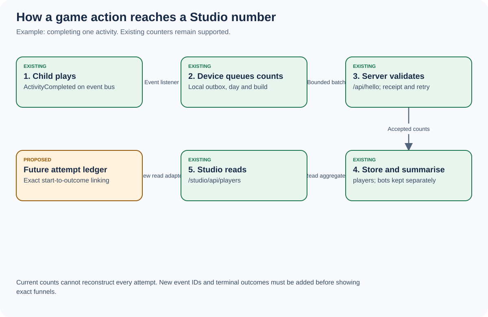

# Data dictionary and exact connection register

Generated from [tools/build.py](tools/build.py). Edit the source, regenerate, and review the diff. Machine-readable copies: [JSON](data-points.json), [CSV](data-points.csv), [graph](connections.json), [metric definitions](metrics.json).

Baseline: `ac76cf6097a8071bf2da4be90fe81fd0af8201d6`. 137 management-relevant field entries; compact transport arrays are expanded slot by slot. This is not a claim to inventory every local gameplay-save field.

Existing means observed in source, not guaranteed production delivery. Proposed means new work. Field families such as festival settings are expanded further by their named runtime types; no unlisted key is automatically permitted.

## ID: identity (existing)

**Source:** `js/players.ts; netlify/lib/hello-clean.mts`. **Transport:** `POST /api/hello`.
**Storage:** device localStorage; players dev/ and info/ records. **Studio:** Device details. **Access:** analytics.

Existing wire names are compact. Do not rename them in place or infer a unique person from an installation.

| ID | Field | Plain meaning | Unit |
|---|---|---|---|
| ID-01 | id | Random installation identifier; resetting storage can create another installation | identifier |
| ID-02 | sid | One running tab/session, not a person | identifier |
| ID-03 | started | Session start; used to avoid treating an older tab as latest | Unix milliseconds |
| ID-04 | b | Build attached to the sending session | build label |
| ID-05 | h | Retry identifier for one hello batch | identifier |
| ID-06 | l | Game language: en, vi or unknown | enum |
| ID-07 | k | Number of profiles on this installation, not unique children globally | count |
| ID-08 | d | Phone, tablet or computer classification | enum |
| ID-09 | a | Standalone/PWA mode observed by browser; not proof of an install event | boolean |
| ID-10 | os | Operating-system family | enum |
| ID-11 | br | Browser family | enum |
| ID-12 | sc | Reported screen dimensions | pixels |
| ID-13 | fh | Digest of a statistics-linking family code; not authentication or photo permission | digest |
| ID-14 | isRobot + traffic | Both flags route synthetic hello traffic into bot-players | classification |

Implementation ticket: **B02** in [build plan](06-BUILD-PLAN.md).

## DAY: game usage (existing)

**Source:** `js/players.ts; netlify/lib/hello-clean.mts; netlify/lib/players.mts`. **Transport:** `POST /api/hello days[]`.
**Storage:** sv2_hello_out -> players d/<day>/<id>, sum/<day>. **Studio:** Home / Analytics / Activity. **Access:** analytics.

The client keeps up to 30 local dates; the server accepts bounded recent buckets. Existing comments mentioning 14 days are stale. Existing day labels lack a reliable timezone conversion.

| ID | Field | Plain meaning | Unit |
|---|---|---|---|
| DAY-01 | days[].d | Day of play recorded on device; late arrivals belong to that day | YYYY-MM-DD device-local |
| DAY-02 | days[].build | Originating build of this bucket, separate from sender build | build label |
| DAY-03 | days[].m | Minutes of active play counted by existing hooks | minutes |
| DAY-04 | days[].g[gameId] | Activity start counts at device level | count |
| DAY-05 | days[].t | Stories opened, not stories completed | count |
| DAY-06 | days[].o | Minutes with friends online | minutes |
| DAY-07 | days[].h[hour] | Play minutes by device-local hour | minutes |
| DAY-08 | days[].q[gameId] | Activities left before completion | count |
| DAY-09 | days[].e[message] | Sanitised game-code error counts | count |
| DAY-10 | days[].s[areaPosition] | Stuck detections; not every instance is necessarily a bug | count |

Implementation ticket: **B02** in [build plan](06-BUILD-PLAN.md).

## KID: profile activity (existing)

**Source:** `js/players.ts listen(), kidOf(); netlify/lib/hello-clean.mts kid()`. **Transport:** `POST /api/hello days[].c[profileKey]`.
**Storage:** players daily children records. **Studio:** Restricted device/activity detail. **Access:** analytics.

This is personal/pseudonymous activity information, not wholly anonymous analytics. Restrict names to operational views; never publish them on /home. Profile participation counts differ from unique activity attempts.

| ID | Field | Plain meaning | Unit |
|---|---|---|---|
| KID-01 | n | Profile first name when name reporting is enabled | text up to 20 characters |
| KID-02 | a | Under-5 versus older age group; not date of birth | little  /  big |
| KID-03 | m | Play minutes for this profile on this device | minutes |
| KID-04 | sm | Minutes on the Simple screen | minutes |
| KID-05 | t | Stories opened by this profile | count |
| KID-06 | g[gameId][0] | Activity starts for participating profile | count |
| KID-07 | g[gameId][1] | Activity completions for participating profile | count |
| KID-08 | g[gameId][2] | Activity abandonments for participating profile | count |
| KID-09 | p[placeId] | Entries into named game places | count |

Implementation ticket: **B02** in [build plan](06-BUILD-PLAN.md).

## PERF: performance (existing)

**Source:** `js/players.ts; netlify/lib/hello-clean.mts; netlify/lib/players.mts`. **Transport:** `POST /api/hello days[].f and days[].st`.
**Storage:** players daily records and report aggregates. **Studio:** Analytics / Performance / Release comparison. **Access:** analytics.

Current arrays contain capped samples. Do not claim population p95 or an exact cache hit rate from them. Render explicit sample counts and measurement limitations.

| ID | Field | Plain meaning | Unit |
|---|---|---|---|
| PERF-01 | days[].f[0] | Sum of sampled frame-rate measurements | FPS sum |
| PERF-02 | days[].f[1] | Number of frame-rate samples | sample count |
| PERF-03 | days[].f[2] | Samples below the existing 20 FPS threshold | sample count |
| PERF-04 | days[].st[][0] | Time until game code is ready | milliseconds |
| PERF-05 | days[].st[][1] | Time until valley is built | milliseconds |
| PERF-06 | days[].st[][2] | Time until first picture | milliseconds |
| PERF-07 | days[].st[][3] | Service-worker-controlled start flag; imperfect warm-cache proxy | 0  /  1 |
| PERF-08 | days[].st[][4] | Slowest named startup stage | stage ID |

Implementation ticket: **B03** in [build plan](06-BUILD-PLAN.md).

## BAT: performance (existing)

**Source:** `js/players.ts sampleDrawing(); netlify/lib/hello-clean.mts BAT_MAX`. **Transport:** `POST /api/hello days[].b`.
**Storage:** players daily battery/drawing arrays. **Studio:** Analytics / Performance. **Access:** analytics.

Battery API is unavailable on many Safari devices. Zero counters without measured battery time mean unavailable, not zero energy consumption. Prefer named adapters to exposing array slots.

| ID | Field | Plain meaning | Unit |
|---|---|---|---|
| BAT-01 | b[0] | Measured drawing minutes | minutes |
| BAT-02 | b[1] | Active frames drawn | frames |
| BAT-03 | b[2] | Time spent drawing measured frames | milliseconds |
| BAT-04 | b[3] | Draw calls on measured frames | calls |
| BAT-05 | b[4] | Pixel ratio multiplied by 100, summed per measured minute | ratio x100 sum |
| BAT-06 | b[5] | Minutes mostly idle | minutes |
| BAT-07 | b[6] | Minutes measured while on battery | minutes |
| BAT-08 | b[7] | Observed battery loss | tenths of one percentage point |
| BAT-09 | b[8] | Minutes charging | minutes |
| BAT-10 | b[9] | Seconds represented by active frame measurements | seconds |

Implementation ticket: **B03** in [build plan](06-BUILD-PLAN.md).

## LIVE: configuration (existing)

**Source:** `studio/ui/app.ts LIVE_PAGES; netlify/lib/live.mts; js/custom.js`. **Transport:** `Studio /studio/api/live or /live/content -> GET /api/live`.
**Storage:** live store: live and content; device sv2_live. **Studio:** Game / Releases / Family content / Activity availability. **Access:** pages to read; edit or releases to write.

Public /api/live is public: never put secrets or private photo bytes here. Its 30-second cache is not a promise that every device applies a change in 30 seconds. Existing timestamps are not delivery acknowledgements.

| ID | Field | Plain meaning | Unit |
|---|---|---|---|
| LIVE-01 | releases[id].on | Explicit feature switch | boolean |
| LIVE-02 | releases[id].start | Scheduled release date | date |
| LIVE-03 | releases[id].days | Availability duration | days |
| LIVE-04 | releases[id].newDays | New-badge duration | days |
| LIVE-05 | releases[id].devices | Selected installation scope; empty is all applicable devices | ID list |
| LIVE-06 | releases[id].levels | Tester mode per selected device | map |
| LIVE-07 | releases[id].peeks | Early-access features | ID list |
| LIVE-08 | releases[id].revert | Default tester exit policy | keep  /  autoplay  /  progress |
| LIVE-09 | releases[id].policies | Per-device revert, speed and autoplay choices | map |
| LIVE-10 | festivals[id].on/date/buildup/deco | Festival enablement, dates and decorations | structured settings |
| LIVE-11 | at / contentAt | Server timestamps for existing live rules/content | ISO timestamp |
| LIVE-12 | content.message | Bilingual message | en/vi text |
| LIVE-13 | content.missions | Family missions | list |
| LIVE-14 | content.quiz | Family quiz questions | list |
| LIVE-15 | content.tales | Family stories | list |
| LIVE-16 | content.names/genders/faces | Villager overrides; private photo references require separate access | maps |
| LIVE-17 | content.looks/plots | Story character and Memory Village configuration | maps |
| LIVE-18 | content.activities | Activity area, little and hide overrides | map |
| LIVE-19 | content.defaults/features | Device defaults and feature switches | maps |
| LIVE-20 | content.ads | Owner-authored ad settings; uploaded pictures may still need Publish | object |
| LIVE-21 | content.album | Family postcard metadata; photo bytes use private services | list |

Implementation ticket: **B06** in [build plan](06-BUILD-PLAN.md).

## CONTENT: catalogue (existing)

**Source:** `js/content/activities.ts; js/games/registry.ts; js/content/releases.ts; js/content/unlocks.ts`. **Transport:** `Versioned game files -> tools/build-website.mts and reviewed website source`.
**Storage:** Git source; generated browser files and /home assets. **Studio:** Activity detail / Content coverage / Website review. **Access:** pages; edit for future editorial work.

The website currently builds from a reviewed prototype via tools/build-website.mts; do not describe a dynamic shared catalogue API as already implemented.

| ID | Field | Plain meaning | Unit |
|---|---|---|---|
| CONTENT-01 | gameId / area / name / icon | Stable activity identity and display catalogue | catalogue entry |
| CONTENT-02 | minimum age / little / difficulty | Suitability and supported game difficulty | catalogue metadata |
| CONTENT-03 | storyId / shelf / pages | Story identity and shelf contents | catalogue entry |
| CONTENT-04 | featureId / default / release rule | What controls activity availability | catalogue entry |
| CONTENT-05 | wins / taleReads / unlock requirements | Local progress used for unlocks; not a business score | local progress |
| CONTENT-06 | BUILD / SHOWN / sw VERSION / studio version | Aligned game/cache/dashboard versions | build labels |
| CONTENT-07 | website source lock / file hashes | Reviewed source fingerprint for parent explanations | source provenance |
| CONTENT-08 | voice language / hash / manifest signature | Recorded-line identity and language-pack revision | manifest metadata |

Implementation ticket: **B05** in [build plan](06-BUILD-PLAN.md).

## WEB: website (existing)

**Source:** `home/analytics.ts; home/site.ts; netlify/functions/parent-analytics.mts`. **Transport:** `POST /api/parent-analytics -> GET /studio/api/parent-analytics`.
**Storage:** parent-analytics sum/<UTC day>. **Studio:** Analytics / Website. **Access:** analytics.

No visitor/session identifier in current website events. Transport is best effort with no durable retry or idempotency key; aggregates use read-modify-write. Embedded website counting is disabled. Event totals are not people or visits.

| ID | Field | Plain meaning | Unit |
|---|---|---|---|
| WEB-01 | page_view.route | Count of allowlisted page-view events | events, not unique visitors |
| WEB-02 | action_click.action | Count of allowlisted actions | events |
| WEB-03 | link_click | Aggregate link clicks | events |
| WEB-04 | scroll_milestone.milestone | 25/50/75/100 percent milestones | events |
| WEB-05 | active_time.seconds | Best-effort active reading time | seconds |
| WEB-06 | play_conversion | Play button clicks; not confirmed game starts | clicks |
| WEB-07 | lang | Language of each accepted event | en  /  vi  /  unknown |
| WEB-08 | device | Viewport-based class attached to each event | phone  /  tablet  /  desktop |
| WEB-09 | sv_parent_analytics_consent | Local opt-out; current default counts unless no | local preference |

Implementation ticket: **B02** in [build plan](06-BUILD-PLAN.md).

## ISSUE: support (existing)

**Source:** `js/tester.ts; js/report-outbox.ts; netlify/lib/tester.mts`. **Transport:** `POST /api/tester -> /studio/api/testers, /testers/problem/<key>, /testers/set`.
**Storage:** Device durable queue; testers private records/screenshots. **Studio:** Attention / Sparkle Lab / Problem detail. **Access:** testers read; testerset update.

Tester entitlement is checked server-side. Existing limits include keepDays=60 and 20 reports/problem. Retention cleanup needs execution monitoring; an automated report is evidence to investigate, not a confirmed defect.

| ID | Field | Plain meaning | Unit |
|---|---|---|---|
| ISSUE-01 | clientId | Durable client receipt/deduplication identity | 32 hex characters |
| ISSUE-02 | id / b / at | Reporting device, build and server receipt time | identity + timestamp |
| ISSUE-03 | kind / auto | Manual report kind or detector category | enums |
| ISSUE-04 | detail / note / spoken | Bounded report explanation and input mode | text + boolean |
| ISSUE-05 | where.area/place/game/window/x/z | Game context, never geographic GPS | context |
| ISSUE-06 | errors / log | Bounded error messages and action history | sanitised lists |
| ISSUE-07 | dev | OS/browser/screen/language and optional performance readings | object |
| ISSUE-08 | players / reporter | Profile context and separately identified report author | restricted metadata |
| ISSUE-09 | shot | Private screenshot requiring sensitive-content masking | private image |
| ISSUE-10 | count | Repeated reports grouped by client detector | count |
| ISSUE-11 | problem key / status / fixedIn | Grouped issue lifecycle and declared fix version | new/fixing/fixed/confirmed/back/notbug/dup |

Implementation ticket: **B04** in [build plan](06-BUILD-PLAN.md).

## PRIVATE: private data (existing)

**Source:** `js/state.ts; js/content/savecopy.ts; js/familydevices.ts; netlify/lib/family-devices.mts; netlify/lib/family.mts`. **Transport:** `Local save/copy; /api/family/*; /api/family-devices/*`.
**Storage:** Device localStorage/IndexedDB/Cache; private family stores. **Studio:** Protected Grown-ups / Studio backup import and family pages. **Access:** family; device credentials for photo collection.

Three separate concepts: statistics linking, private photo sharing, and explicit progress backup/restore. Never use one credential to grant another capability.

| ID | Field | Plain meaning | Unit |
|---|---|---|---|
| PRIVATE-01 | profiles / farm / settings | Local authoritative play state; not remote cloud-save authority | save objects |
| PRIVATE-02 | save copy v3 / device | Explicit portable backup and installation association | validated file |
| PRIVATE-03 | photo family membership / device approval | Parent-owned private photo collection membership | private records |
| PRIVATE-04 | pairing code / recovery / session token | Photo-access credentials; never analytics dimensions | secrets |
| PRIVATE-05 | Studio family photo reference | Opaque family:<random-name>, not public image bytes | private reference |
| PRIVATE-06 | statistics family code digest | Links statistics only; distinct from photo access and save transfer | pseudonymous link |

Implementation ticket: **B01** in [build plan](06-BUILD-PLAN.md).

## OPS: operations (existing)

**Source:** `netlify/lib/admins.mts; netlify/lib/accesslog.mts; netlify/lib/child-bots.mts; studio/core.cts`. **Transport:** `/studio/api/*; GitHub workflows; publish pipeline`.
**Storage:** studio-admins; studio-log; live bot-schedule; studio-pending and studio-draft. **Studio:** Setup / Security / Publish / Sparkle Lab. **Access:** existing server-side permission map.

Existing access log is not a complete before/after configuration audit. Provider run results and billing are not automatically available to Studio just because Git reads work.

| ID | Field | Plain meaning | Unit |
|---|---|---|---|
| OPS-01 | account role / perms | Viewer/editor/owner/custom permissions | permission set |
| OPS-02 | trusted browser / Studio key | Revocable authentication grants | private credentials |
| OPS-03 | access log at/who/role/what/where/note | Restricted sign-in and selected-action evidence | audit entry |
| OPS-04 | pending path / size / deletion | Changes held before publishing | file manifest |
| OPS-05 | draft / main commit / deploy ID | Source and deployment provenance | version IDs |
| OPS-06 | bot enabled/schedule/time/count/profile/duration | Private synthetic-run schedule; clock currently UTC | bounded configuration |
| OPS-07 | workflow run / result artifact | CI, bot and voice-job results | run references |

Implementation ticket: **B07** in [build plan](06-BUILD-PLAN.md).

## EVENT: future measurement (proposed)

**Source:** `js/core/events.ts; js/players.ts; js/launch.js; js/net.ts; js/voice.ts`. **Transport:** `NEW POST /api/management/events`.
**Storage:** NEW transactional management event ledger; current save stores unchanged. **Studio:** Activity funnel / Retention / Performance / Connections. **Access:** analytics.read proposed; public ingest has no read access.

These events are a new protocol, not existing event-bus payloads. Full boot-failure population is unobservable when code never runs or sends. Use non-authoritative public telemetry with rate limits, not as proof of game rewards.

| ID | Field | Plain meaning | Unit |
|---|---|---|---|
| EVENT-01 | schemaVersion / eventId / payloadHash | Versioned validated event and duplicate identity | version + UUID + digest |
| EVENT-02 | deviceId / sessionId / attemptId | Installation, session and one activity attempt; no child name | scoped IDs |
| EVENT-03 | occurredAt / receivedAt / deviceDay / offsetMinutes | Separate event time, receipt time and local-day provenance | UTC timestamps + local label |
| EVENT-04 | build / sourceCommit / environment / traffic | Release association and ordinary/test/bot classification | provenance |
| EVENT-05 | activity.started/completed/abandoned | Attempt lifecycle with terminal outcome exactly once | events |
| EVENT-06 | boot.started/ready/failed | Eligible boot attempts and result, when reportable | events |
| EVENT-07 | story.opened/completed | Story lifecycle with explicit completion definition | events |
| EVENT-08 | connection.attempt/result | Join attempts and outcomes, no room codes or media | events |
| EVENT-09 | voice.playback/result | Recorded/family/device source outcome; no speech text or names | events |
| EVENT-10 | backup.result / update.result | Operation result only; never backup contents | events |

Implementation ticket: **B08** in [build plan](06-BUILD-PLAN.md).

## DELIVERY: delivery (proposed)

**Source:** `netlify/lib/live.mts; js/custom.js; netlify/functions/studio.mts`. **Transport:** `NEW revisioned mutation + POST /api/management/config-receipts`.
**Storage:** NEW revision/config/receipt tables; projections into existing public response. **Studio:** Release / Change detail / Device detail. **Access:** configuration.write proposed; acknowledgements contain no permission grants.

An offline device stays unconfirmed. No command may remotely overwrite saved progress. Revision acknowledgement means configuration handling, not that every feature was played.

| ID | Field | Plain meaning | Unit |
|---|---|---|---|
| DELIVERY-01 | configRevision / contentRevision | Monotonic per-scope revisions assigned by service | integer |
| DELIVERY-02 | scope / effectiveConfigHash | Resolved device scope and applied configuration fingerprint | scope + hash |
| DELIVERY-03 | availableAt / fetchedAt / appliedAt | Evidence for separate delivery stages | timestamps |
| DELIVERY-04 | applicationResult / reasonCode | Applied, rejected or unsupported; bounded failure reason | enum |
| DELIVERY-05 | expectedDeviceCohort / observedDeviceCount | Snapshot of eligible recently reporting installations | counts + cohort timestamp |
| DELIVERY-06 | previousRevision / actor / reason | Before/after change audit and optimistic concurrency | audit record |

Implementation ticket: **B09** in [build plan](06-BUILD-PLAN.md).

## MONEY: finance (proposed)

**Source:** `NEW owner-entered ledger / provider billing adapters`. **Transport:** `NEW /studio/api/management/finance/*`.
**Storage:** NEW private ledger, budgets, rate cards and imports. **Studio:** Analytics / Finance. **Access:** finance.read or finance.write proposed, owner-only initially.

No current revenue or finance feed exists. Manual records first. Missing invoices mean incomplete spending, not zero. Reporting currency AUD is a proposal; never silently mix currencies.

| ID | Field | Plain meaning | Unit |
|---|---|---|---|
| MONEY-01 | provider / accountAlias / invoiceId / lineId | Source identity and duplicate-import key | identifiers |
| MONEY-02 | periodStart / periodEnd / usageQuantity / usageUnit | Billing period and measured usage | date + quantity |
| MONEY-03 | amountMinor / currency / taxMinor / category | Actual cost using integer minor units | money |
| MONEY-04 | kind / recognisedAt / paidAt | Actual, estimate or commitment with distinct recognition/payment dates | classification |
| MONEY-05 | budgetMinor / forecastMinor / asOf | Budget and dated forecast | money + timestamp |
| MONEY-06 | fxRate / fxSource / fxAsOf | Explicit conversion into reporting currency | decimal + provenance |
| MONEY-07 | revenueMinor / feeMinor / refundMinor | Only if an approved revenue model exists | money |
| MONEY-08 | allocationRule / activeDeviceHours | Transparent cost allocation denominator | rule + measured hours |

Implementation ticket: **B10** in [build plan](06-BUILD-PLAN.md).
