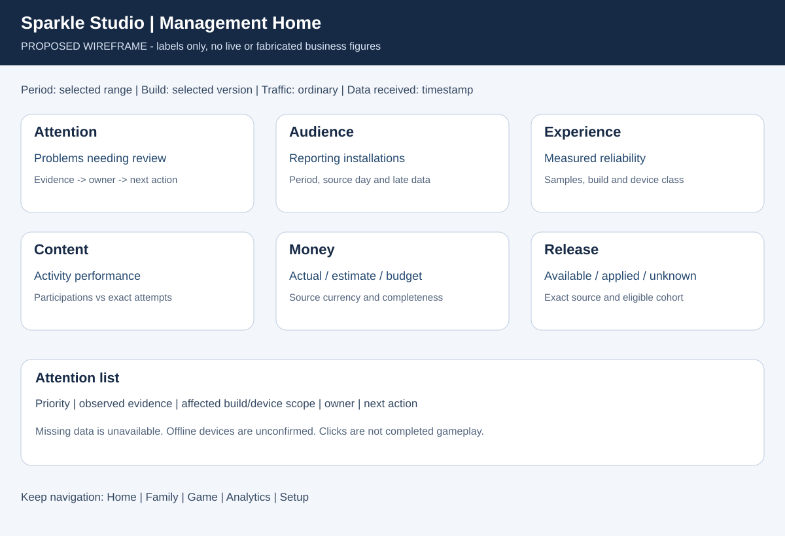
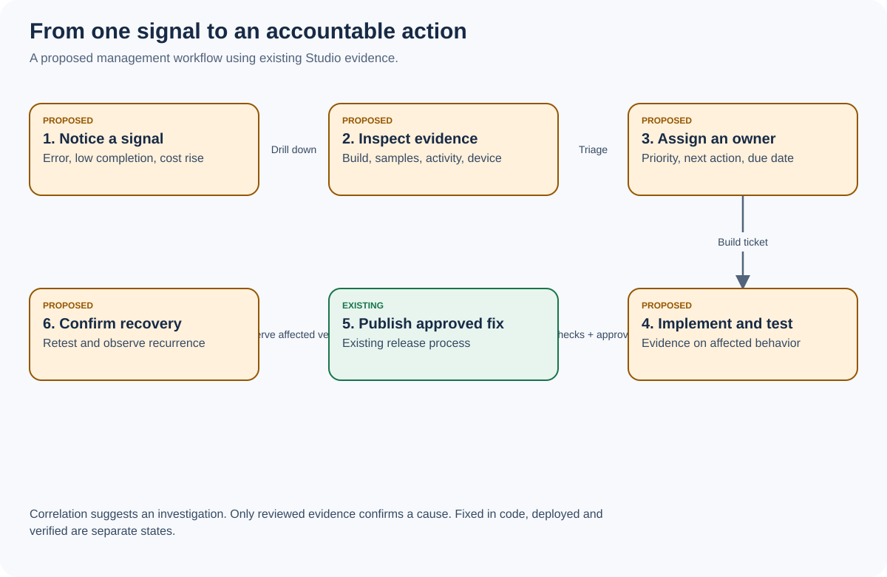

# Studio screens, permissions and daily decisions

All new layouts below are proposed. Preserve the existing five-section navigation and shared online/local UI. Parent website navigation stays separate with its existing four destinations. Existing game art, bilingual labels, stable shells and touch-target rules still apply to production implementation. The documentation guide uses its own neutral diagram style and is not a replacement game UI.

## 1. Navigation and information hierarchy

| Existing section | Keep | Add within that section |
|---|---|---|
| Home | Existing shortcuts and publishing visibility | Six management cards, freshness, attention summary, last verified release |
| Family | Messages, missions, Children backup editor, album, quiz, stories, villagers, Memory Villages, family code | Content coverage, clearer scope and delivery explanation; no cloud-save editor |
| Game | Releases, Sparkle Lab, festivals, characters, Simple screen, music, map, photos, defaults, voices, ads | Activity detail, effective availability explanation, release comparison and application receipts |
| Analytics | Existing usage and tester views | Audience/retention, Experience, Content, Website, Finance and definitions as subordinate views |
| Setup | Publish, Website, Check, Settings, Admins, Security, Access log | Operations, integrations, budgets/quotas, job health, recovery evidence and configuration history |

Every new view follows the same chain: summary -> evidence -> permitted action -> confirmation/result -> verification. Preserve filters and scroll when returning. An activity page launched from Attention returns to the same attention list and filter; it does not send the operator to a default home screen.

## 2. Home wireframe



```text
Sparkle Studio                       Period | Build | Ordinary traffic
Data received: ...   Source day basis: ...   Some reports arrive late

[Attention]       [Audience]          [Experience]
3 need review     Reported devices   Reported errors / startup
[Content]         [Money]             [Release]
Starts/outcomes   Actual / forecast  Live / candidate / unconfirmed

Priority | Evidence | Affected scope | Owner | Next action
...

Last successful jobs | Data gaps | Definitions | Changes awaiting review
```

The numbers above are schematic labels, not live data. Home must remain useful when only existing data is available: show website clicks and reported starts separately, legacy participation ratios explicitly, and Finance as not configured rather than invented values.

Each card requires: title, value/status, unit, comparison period if compatible, sample/eligible count, source freshness, short meaning, limitation disclosure and one primary destination. Negative trends use text as well as colour. Critical known failures can surface immediately; comparative trend alerts require adequate samples.

## 3. Screen specifications

| Screen | Required information | Actions | Empty / failure behavior |
|---|---|---|---|
| Attention | Signal ID, severity, observed/reproduced distinction, originating build, affected count, evidence age, owner, next action | Assign, add investigation note, open linked problem/activity/release | No signals differs from no reporting; unknown cause stays unknown |
| Activity detail | Stable ID, EN/VI name, category, available/hidden/locked reason, supported difficulty/mode, usage definition, recordings, guide source, tests, reports | Open existing feature control, open guide preview, assign issue, request review | Unknown catalogue ID 404; missing recordings/guide clearly marked |
| Device list | Installation alias/ID, class, latest reporting build, last receipt, presence, sample health, test classification | Filter/paginate/open detail; label if permitted | Never imply list cap is total population; show eligible count and cursor |
| Device detail | Version/session provenance, observed performance, pending configuration, problems, restricted profile context only if permitted | Existing tester policy edit, diagnostic guidance, open issue | Offline is unconfirmed; no raw backup/photo/code/token display |
| Release comparison | Exact source/deploy IDs, aligned game/Studio/cache versions, comparable period/platform cohorts, tests, retries/skips, coverage gaps | Open evidence, prepare approval report; approved owner deployment remains external gate | Missing CI result is pending/unavailable, not pass |
| Change detail | Actor/reason where permitted, scope, before/after summary, revision, state, availableAt, fixed eligible cohort, received/applied/rejected/unconfirmed | Reload conflict, retry safe projection, propose compatible rollback | Save conflict keeps local draft; no silent overwrite |
| Website | Page/action counts, Play clicks, reading time, source review status, guide coverage | Open page/guide review, compare source lock | No invented unique visitors, acquisition conversion or child-level joins |
| Finance | Period, source currency, tax basis, import completeness, actual/estimate/commitment, budget, forecast, assumptions | Preview import, reconcile, correct with reason, set budget | Missing invoices/FX are incomplete/unavailable; no automatic payment |
| Operations | Service/feed status, last observed response, last successful job, run/source ID, queue age, quota units/window, backup restore evidence | Read diagnostics, permitted bounded retry/run, open provider link | Dispatch accepted differs from completed; external unavailable differs from service confirmed down |

## 4. Availability explanation

An operator must be able to answer “Why can this device not see this activity?” The page lists the evaluated gates in order: known catalogue/build, release hold, feature/default rule, device targeting, schedule window, tester early access, completion/unlock requirement, local compatibility and last observed configuration. The adapter calls the existing resolution functions or a shared pure equivalent with parity tests. It must not reimplement a slightly different guess in the browser.

Show the winning rule and source, not only a toggle. A previously tried feature may be retained by `keptOn`; `wayfind` has special control semantics. Exact precedence is a B06 implementation deliverable. For an unreported device, show an evaluated server-side expectation and explicitly say actual device state is unknown.

## 5. Permissions and actions

| Capability | Existing permission / proposed addition | Default |
|---|---|---|
| Existing analytics | `analytics` | Existing preset behavior unchanged |
| Existing tester reports / status | `testers`, `testerset` | Existing behavior unchanged |
| Edit live content / release rules | `edit`, `releases` | Existing server-side permission and scope checks |
| Manage photos / make new family code | `family`, `familycode` | Keep distinct permissions |
| Publish family files / merge code | `publish`, `deploy` | Keep distinct permissions; editor is not a code deploy grant |
| New nonpersonal management summary | `management.read` | Owner only until explicitly granted |
| New restricted device detail | `management.deviceDetail` | Owner only until explicitly granted |
| New attention assignment/status | `management.triage` | Owner only until explicitly granted |
| Finance read/write | `finance.read`, `finance.write` | Owner only initially; never inherited from generic Analytics |
| Provider operations read/run | `operations.read`, `operations.run` | Owner only until explicitly granted |

Register new permission metadata and explicit preset behavior on the server. Do not let the existing “all keys” editor preset accidentally inherit newly added finance or operations privileges. Update preset construction to an intentional allowlist in that implementation ticket, with regression evidence. Test GET and POST with every role, custom grants and desktop key; the current scoped desktop key must not acquire finance/deployment capabilities automatically.

Configuration screens must state scope, effect timing, reset consequences and data-retention policy before Save. Preview for an irreversible or sensitive action must include its exact target and outcome. This design contains no remote erase-progress action, financial payment button or automatic external email/Slack messaging.

## 6. Mobile, accessibility and language

- Fixed outer shell; header and primary actions remain accessible, body scrolls. Reserve keyboard/safe-area space and preserve draft state through recoverable request failures.
- At least 44 px hit areas in Studio; use established larger targets for child-facing controls. Essential explanations visible on touch, not hover-only.
- English and Vietnamese cover titles, definitions, server errors, scope labels, financial classifications and unavailable states. Store stable IDs independent of translated names.
- Common filters collapse into a clearly labelled control on phone. Never hide the selected build, period or test-traffic state. Avoid a wide desktop table as the only way to inspect evidence.
- Readable contrast, keyboard focus, reduced motion, focus return and live-status announcements. No colour-only status. Graphs include units and tabular alternatives.
- Metric drill-downs state whether numbers are device counts, profile participations, attempts, events or money. Help explains these in ordinary language.

## 7. Signal and support lifecycle



Proposed attention states: observed -> investigating -> reproduced -> fixing -> fixed_in_code -> deployed -> verified, with reopened/dismissed/duplicate branches. Preserve the existing tester problem states through an adapter rather than renaming stored records. Mapping: new -> observed; fixing -> fixing; fixed -> fixed_in_code unless deployment evidence exists; confirmed -> verified only with relevant evidence; back -> reopened; notbug -> dismissed; dup -> duplicate.

Every transition records actor, time, reason, expected revision and evidence reference. No automatic report can mark its own cause confirmed. No passing unit suite alone can verify a production-device fix. A candidate release can close a code task while its verification task stays open.

Initial alert proposals: an acknowledged data-loss report, publication failure or unauthorised-write test failure is immediately high priority. Trend alerts compare compatible build/platform cohorts with at least 20 samples, show absolute change and percentage, and require a configurable baseline. Costs/quotas alert at 70%, 90% and 100% of an explicitly configured budget/limit, with missing/stale input shown first. These thresholds require owner review before activation. Alerts stay inside Studio unless a separate external notification channel is authorised.
