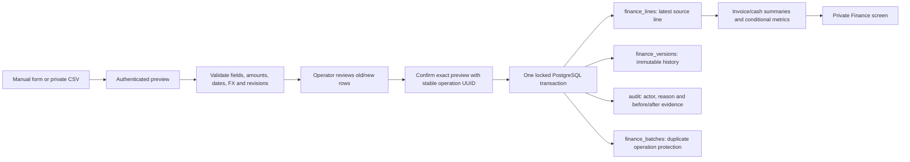
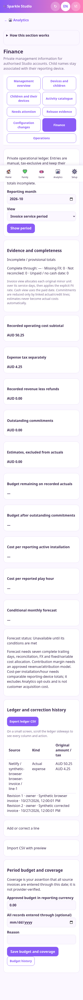
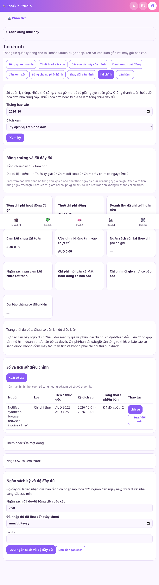
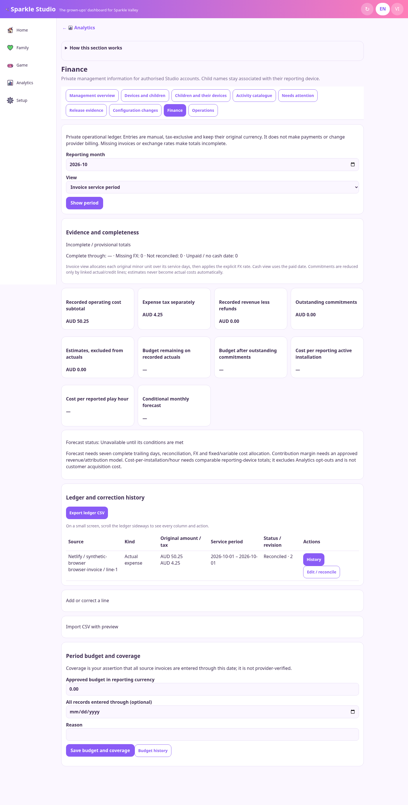

# Finance handbook: private manual ledger

27 October 2026 AEDT. This implements the manual-first part of **B10**, with **B07** permissions/audit and **B12** validation. The owner has now authorised finance work; the earlier deferral is historical. It does not approve a payment system, revenue model, tax filing, paid service, or production activation.

## What you can do

Open **Studio → Analytics → Finance**. Connect Netlify Database and explicitly apply migration v2 before real use. An owner can start the ledger and choose a reporting currency. AUD is the proposed default; the original currency remains on every line. Once a line exists, the reporting currency is locked so existing FX does not silently change meaning.

Enter an invoice line, estimate, commitment, expense credit, revenue entry or revenue refund. A revenue entry records evidence supplied by the operator; it does not add purchases to the game. Amounts exclude tax, with tax entered separately. Use a decimal point and the currency's correct number of decimal places. AUD/USD have two, VND/JPY zero, KWD/BHD three. The server stores exact integer minor units and uses integer/rational arithmetic; it never calculates money using binary floating point.

Give a provider/source name, a non-secret account alias, document ID and line ID. These four fields identify a source line; its internal key is their hash. Two different accounts may legitimately have the same invoice number. Identifiers must begin with a letter/digit and contain only the allowed ordinary identifier characters. Do not enter credentials, card details, bank details or invoice attachments. There is no attachment collection.

**Preview** shows each new, duplicate or corrected row and the old/new amount before anything is saved. **Confirm reviewed entries** commits that exact preview atomically. A stable operation ID protects retries. Reimporting an unchanged source line does not create another expense. A changed line needs its current revision; a competing editor produces a conflict and requires reload/review. Never create a second source ID merely to bypass a correction conflict.

**Edit / reconcile** loads the same source identity for correction. Reconciled means the operator compared the record with the source document; it is not provider verification. **Void** excludes a mistaken entry from totals but preserves every version. Changing a source identity requires voiding the old line and creating the correct one. A referenced commitment cannot be voided while active settlement lines still point to it.

Every mutation records the actor, reason, time and revision. Line history retains the original and corrected versions. Budget history retains old/new values and reasons. The database adapter treats version, batch and audit records as insert-only through these application paths. No application path deletes financial history.

## Exact data flow

| Data | Origin → destination | Connection to game / website |
|---|---|---|
| Original amount, currency, tax, source IDs, service dates, recognition/paid dates | Manual form/CSV → `normalLine` → transactional ledger | No child/profile/device identifier is stored in a financial line |
| FX rate, source and date | Explicit operator input → original line/version | No inferred live FX or currency mixing |
| Fixed/variable/unallocated classification | Operator → line | Needed for a defensible forecast; missing classification blocks it |
| Commitment settlement | Actual/credit line → commitment hash | Same provider/account/currency/cost type required; outstanding amount is reduced once |
| Month budget and coverage-through date | Operator → versioned budget and immutable audit | Coverage is an operator assertion, not a provider invoice completeness guarantee |
| Cost per reporting active installation | Complete, reconciled, converted invoice cost ÷ existing ordinary active-installation total for the same calendar month | Installation denominator, not unique children, customers or acquisition cost; Analytics opt-outs bias it |
| Cost per reported play hour | Same cost ÷ existing reported minutes / 60 | Null for zero/missing minutes; never an invented infinite or zero unit cost |
| Website purchases / payments | No connection is created | Revenue attribution and contribution margin remain unavailable until a revenue model and attribution rules are approved |

The finance API consumes aggregate gameplay denominators only. It does not join invoices to child names or introduce a website tracking token. The public game and website cannot read the ledger.

## Invoice, cash, tax and FX rules

- **Invoice service-period view:** spread each original minor unit over inclusive service days. Earlier days receive indivisible remainder units. Select the requested calendar-month portion, then convert using the explicit FX rate and currency exponents. This is a documented operational allocation, not a statutory accounting policy. The entered recognition date remains preserved for source evidence; it does not replace the service-period allocation.
- **Cash view:** include actual expense/credit/revenue only on its paid/received calendar date. A missing paid date means unpaid or unknown; it is shown separately and prevents a claim of complete cash reporting. Estimates and commitments are excluded.
- **Tax:** expense tax and revenue tax remain separate from tax-exclusive cost/income. A refund/credit has the appropriate negative amount/tax sign. The tool does not infer recoverable tax, GST treatment or a tax return.
- **FX:** one original major unit equals the entered number of reporting-currency major units. Example: VND 10,000 × AUD 0.00006 = AUD 0.60 = 60 Australian cents. A positive decimal string is required, with provenance. Rounding is half away from zero. Missing FX leaves that line unconverted and marks totals incomplete; it never becomes zero. Same-currency rates cannot contradict 1:1 conversion.
- **Commitments:** only explicitly linked actual/credit lines reduce an outstanding commitment. Over-settlement clamps the outstanding reserve to zero; the full actual expense remains visible. Distinct unlinked actuals do not magically settle a contract. The remaining reserve is allocated proportionally across its original service period; this is an operational planning convention.
- **Estimates:** shown separately and excluded from actual cost. To replace an estimate with an actual, correct the same source identity at the expected revision.

A recorded subtotal is not a completeness claim. Complete comparable totals require operator-confirmed coverage through month end, reconciliation and all needed FX. Coverage cannot be declared for a future date. Budget balances remain visibly provisional while source coverage is incomplete.

Forecasting is available only for the current invoice month after at least seven complete trailing days, with coverage through yesterday, FX, reconciliation and cost classification. It combines fixed actuals, outstanding fixed commitments, variable cost to yesterday and the remaining-days projection from the trailing seven-day variable mean. Variable/unclassified commitments block the forecast to avoid overlap with the variable trend. Daily forecast allocations partition each converted monthly amount exactly; they are not metered provider consumption. The forecast is conditional on these assumptions, not a bill prediction.

Contribution margin remains null: attributed variable cost and an approved revenue model do not yet exist. Recorded revenue/refunds are shown without presenting them as game conversion or profit attribution.

## CSV and correction workflow

The [finance input schema](schemas/finance-line.schema.json) documents the wire fields; `finance-values.mts` also enforces source identity, signs, overflow and cross-record settlement rules. Use **Export ledger CSV** as the template. Source amounts are integer `amountMinor` and `taxMinor`; `expectedRevision` is 0 for a genuinely new line or the current revision for a correction. The export is authenticated and private/no-store. It includes voided rows so history is not silently dropped.

1. Keep the header names. Import at most 200 lines / 180,000 characters at once.
2. Keep source IDs stable. Preserve original currencies and service dates.
3. Optional FX columns are `fxTargetCurrency`, `fxRate`, `fxSource`, `fxAsOf`.
4. Preview the entire import. Malformed quoting, unknown/duplicate columns, conflicting source identities, bad dates, fractional minor units and stale revisions are rejected.
5. Confirm with a reason. One failure prevents all line/version/audit writes in that batch. A lost acknowledgement can be retried with the same operation ID; the source-line hash also prevents duplication after reload.
6. Review reconciliation and coverage, then set the approved budget. Export/review privately; do not commit real financial files to GitHub.

The form and preview are session drafts; reloading before confirmation discards the draft, not saved ledger history. A confirmed response is required before treating an import as saved.

## Access and setup

`finance.read` grants ledger/summary/history/export. `finance.write` grants setup, preview, import/correction/reconciliation and budget edits. Existing viewer/editor presets gain neither; owners have access. Other administrators need explicit owner-assigned grants. Desktop keys are denied finance even if an old key claims such strings. Server checks are authoritative.

Netlify's context-specific `NETLIFY_DB_URL` remains the SQL binding. Migration `002-finance.sql` expands allowed typed namespaces without changing migration v1 bytes or deleting existing records. The trusted migration tool validates every installed checksum and applies missing versions transactionally. Preflight now requires both versions. Never run production migrations from a public request or treat local synthetic PostgreSQL as Netlify account validation.

Current bounds: the shared adapter rejects reads above 10,000 records per namespace rather than silently truncating totals. Large-ledger pagination/rollups, automatic provider billing imports, statutory accounting, bank/payment integrations, scheduled exports, financial retention policy and production backup/recovery drills remain future work. The existing event privacy/retention work is also separate.

## Visual evidence

Actual authenticated screens with synthetic invoices, never real financial records:

| Phone | Tablet | Computer |
|---|---|---|
|  |  |  |

See [plan traceability](PLAN-TRACEABILITY.md) and [implementation validation](IMPLEMENTATION-VALIDATION.md). Production access is still a separate prerequisite; this work does not claim Netlify Database is connected here.
