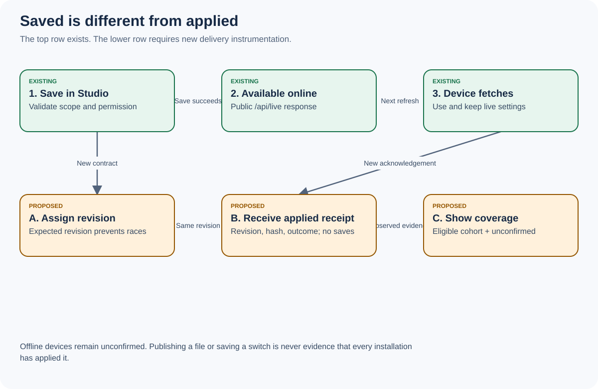
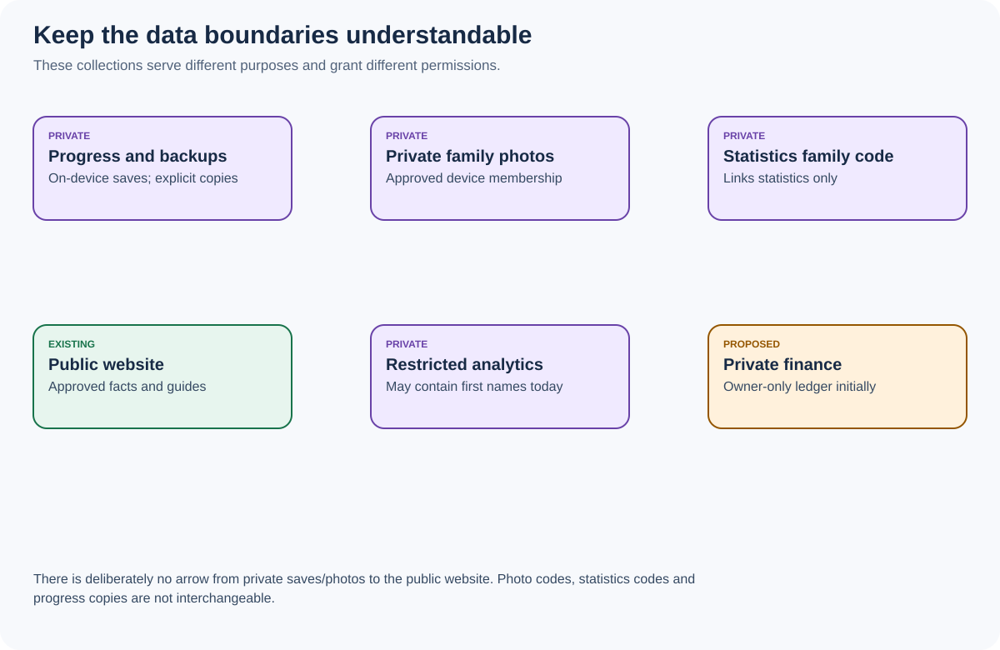
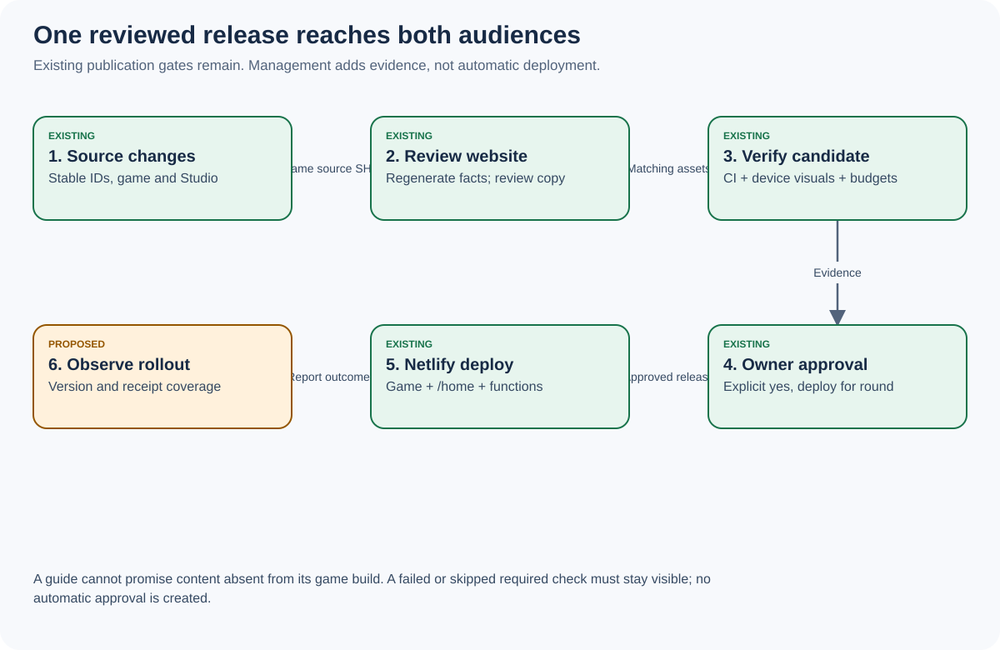

# The handbook: understand before building

## 1. What we are building

Sparkle Valley has three experiences. The child uses the game to play. A parent uses the website to understand the game. The owner and authorised administrators use Studio to manage it. The proposed work gives Studio a clearer picture of what is happening and a shorter route from a problem to a safe action.

Think of a restaurant. The game is the meal, the website is the menu, and Studio is the manager's office. The menu must describe food the kitchen can actually serve. A sales report does not change a customer's meal. A kitchen problem needs evidence and an owner. The same boundaries apply here.

The system must answer: What is happening? Can we trust this number? Who is affected? What changed? Who owns the next action? Did the action work? What did it cost?

## 2. The six kinds of information

| Kind | Example | Where it belongs | What it must not become |
|---|---|---|---|
| Product facts | Activity ID, supported languages, reward requirements | Versioned game catalogues; reviewed website generation | Three manually maintained conflicting catalogues |
| Live configuration | Feature switch, festival date, tester device policy | Existing live service; later revisioned changes | Executable commands that overwrite children's saves |
| Play state | A child's coins, purchases and progress | Device save and explicit backup/restore | A dashboard's editable business aggregate |
| Observed activity | Reported minutes, starts, completions, errors | Restricted analytics with provenance | A claim to measure all children or learning ability |
| Operational evidence | Bug reports, tests, workflow results, deployment IDs | Restricted Studio operational views | An automatic declaration that every reported issue is a defect |
| Money | Invoice lines, budgets, estimated future costs | Proposed private finance ledger | Estimates labelled paid invoices or game coins labelled revenue |

## 3. A real example: one child completes Ô Ăn Quan

1. The game identifies the activity with its stable catalogue ID, `oanquan`, rather than its translated label.
2. The current activity system emits start/completion events. `js/players.ts` listens and adds bounded counts to the device's daily outbox, tagged with the originating build.
3. With Analytics enabled and a working connection, the device posts a batch to `/api/hello`. Repeated transmission keeps the same batch identifier until acknowledged.
4. The server checks types and limits, cleans the fields, routes synthetic bots separately, and updates its reporting records.
5. Studio requests `/studio/api/players`. Its activity/device views can display reported starts/completions with their scope and limitations.
6. The parent website can explain the activity using reviewed source facts. It does not receive this child's private save or analytics record.
7. A proposed Activity page joins the activity ID to its usage, open problems, recordings, guide and release evidence.

There is an important gap: current daily counts do not record a complete sequence for every attempt. A start just before midnight and a finish after midnight can land in different buckets. An attempt played by two profiles creates two profile participations. Exact conversion requires the new `attemptId` contract before that number is offered.

## 4. Another example: change a festival date

Today, an authorised Studio user can save a live festival rule. The live store changes; the game can fetch `/api/live` and keep the result. That proves availability of the new setting, not universal receipt.

The proposed change adds a revision number. A device reports which revision it fetched and whether it applied the resolved settings. Studio shows the eligible reporting cohort, confirmed applications, rejections and devices with no confirmation. A device offline for a month must not be shown as successfully updated.

The public website currently receives its explanations through its reviewed build pipeline. A website calendar does not automatically follow every live game switch. The build work must explicitly choose which public calendar facts use a bounded public projection and which remain release-time facts. Parent-facing guides must explain device-specific rollout generally; they cannot reveal tester IDs.

## 5. A parent clicks Play on the website

The standalone website records a best-effort Play-click event. That does not prove the game loaded or a child played. The user might close the page, lose the connection or use an installed PWA later.

Show three separate measures: website Play clicks; reportable game boots; reported activity starts. Do not draw a measured person-level funnel connecting them without an additional approved attribution design. The first implementation deliberately has no cross-site child identity or tracking-token join.

Inside the game, the website opens in its own frame. The game passes language and accepts only the expected close/play navigation messages from that exact frame and origin. Embedded website analytics are disabled. Reading the floating website should not count as playing the game.

## 6. Three things called family must stay separate

**Statistics family code:** links installations' statistics using a digest. It does not share photos or progress.

**Private photo connection:** a separate service with approved devices, pairing and recovery credentials. It gives access to that private collection, not permission to read game saves.

**Save a copy / Load a copy:** explicit validated progress transfer. It has its own confirmation, compatibility and recovery rules. Studio's Children page imports a backup file and exports another; it is not a remote cloud-save editor.

## 7. What the owner sees every morning

Home has six concise cards: Attention, Audience, Experience, Content, Money and Release. Each shows scope, time period, freshness and whether it is existing, derived, estimated or unavailable. Tap a card to see evidence, then an action permitted for that account.

Example: “Reported first-picture time increased on Android in v1.02; 27 comparable samples.” Tap it to compare distributions and builds, open affected device classes, inspect the candidate's test evidence, and assign investigation. This example is fictional; no actual regression is asserted.

An automatic pattern is an investigation lead. A person or reviewed reproducible test confirms the cause. Fixed in code, deployed and verified on a relevant device are different milestones.

## 8. What the finance operator sees

Actual expenses come from invoices/imports or explicit manual records. Budgets are approved limits. Commitments are expected charges. Forecasts are estimates. They must have different labels and reconciliation states.

Example: AUD 120 actual, AUD 30 reserved commitments, AUD 200 budget. Actual-only remaining is AUD 80; commitment-adjusted remaining is AUD 50. Never present both as the same balance. Game coins are virtual progress, not revenue. Revenue metrics stay unavailable until there is an approved commercial model and actual accounting input.

Cost per reported play hour can be useful but is biased by Analytics opt-outs and offline arrivals. It is not cost per paying customer. The denominator and its limits stay visible.

## 9. How releases reach people

Game code, Studio version and service-worker version remain aligned under Release ownership. The website is generated/reviewed against the intended source. Required checks, visual evidence and performance checks precede the owner's explicit release approval. Netlify then publishes the approved candidate.

A management console can assemble evidence and show rollout health. It must not replace the deployment gate. A failed production update cannot be resolved by deleting a family's saved progress. A rollback also needs compatibility checks for saved data and current live configuration.

## 10. What every builder must do

1. Read this package and the repository's current rules. Use the existing isolated checkout; do not create a worktree unless the owner asks.
2. Pick one [build ticket](06-BUILD-PLAN.md). Read its dependencies and reserved decisions.
3. Identify the exact fields it consumes in the [data register](02-DATA-DICTIONARY.md), and its formulas in [metrics](03-METRICS.md).
4. Keep existing wire fields and saves compatible. Put new behavior behind the proposed management flag until validated; the flag itself needs a registered Studio control and server-side scope handling.
5. Implement the server permission and validation before exposing a writable UI. Hiding a button is not access control.
6. Run the ticket's meaningful acceptance cases, including failure paths. Record exact source and observed results. Never substitute a zero-test run for validation.
7. Test both Studio modes, EN/VI, phone/tablet/computer where UI changes apply. Automated screenshots do not replace relevant real-device checks.
8. Update the registers, status and evidence. Stop at the approved deployment gate. An undocumented external prerequisite is not a completed feature.

## 11. Plain-language glossary

| Term | Meaning |
|---|---|
| Source of truth | The designated place allowed to define a fact |
| Catalogue | A list of activities, stories or other product items with stable IDs |
| Event | A record saying something happened, rather than a command to change progress |
| API | An agreed door through which one program asks another for data or an action |
| Schema | The allowed fields, types and limits for that conversation |
| Outbox | A device's waiting list of reports it has not received confirmation for |
| Acknowledgement / receipt | The server confirms storage, or a device confirms handling a configuration |
| Idempotent | Sending the same request again does not count or apply it twice |
| Revision | An ordered version of one configuration scope |
| Rollup | A summary calculated from detailed records |
| Cohort | A fixed group selected by the same rule, such as first-observed installations on one date |
| Denominator | The eligible population underneath a percentage |
| Provenance | Where a value came from, when, and under which build/formula |
| Transaction | Related database writes succeed together or do not happen |
| Concurrency conflict | Two editors changed the same thing; one must reload and reconcile |
| Unavailable | The data needed to calculate a trustworthy value is missing |
| Synthetic traffic | Automated tests/bots, separated from ordinary usage |
| Pseudonymous | Identified by a code rather than necessarily a real name; still linkable information |
| Acceptance criterion | An observable result that must be demonstrated before completion |

## 12. What this foundation does not promise

It cannot reveal all unreported/offline behavior, turn completion counts into educational assessment, infer exact battery energy on unsupported browsers, determine a unique child across devices, or retrieve billing/production data without the relevant authorised access. Those limits are part of each screen's contract, not errors to hide with invented values.
