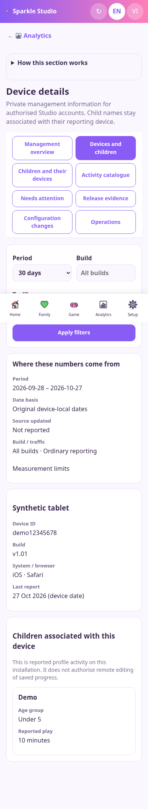
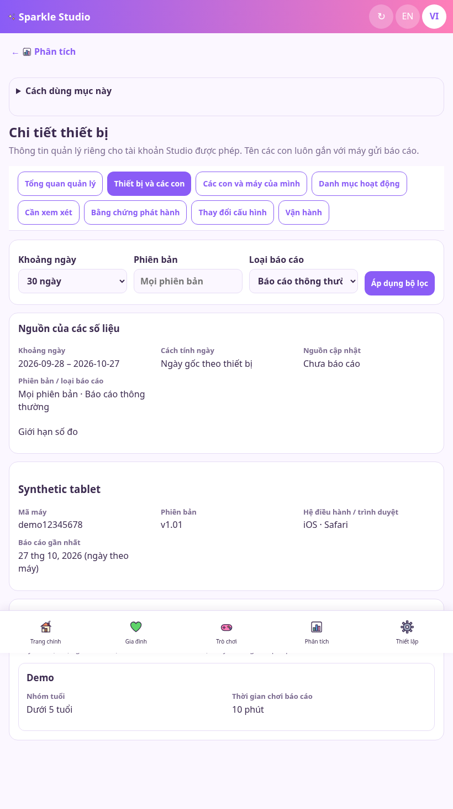
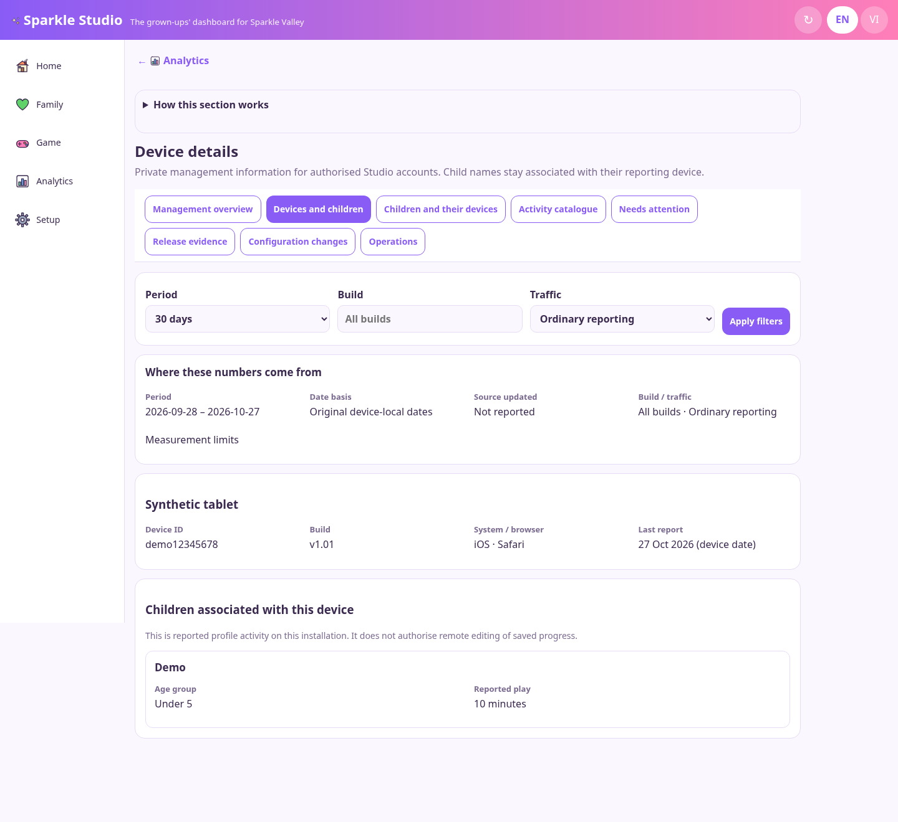

# Studio implementation and operator handbook

27 October 2026, Australia/Sydney (AEDT). Branch `work`; game version stays v1.01. This is the current implementation record. The original handbook and registries describe the larger design at commit `ac76cf60`; they are not a completion checklist.

The owner authorised implementation, requested child names alongside devices, deferred finance input, and requested one active agent. Saved contributions were integrated by the primary agent after the parallel workers stopped. No production deployment, paid database provisioning or version change has been performed.

## Start here, without technical knowledge

Open Studio, sign in, then open Analytics. **Management overview** shows the reporting audience, play time, experience and evidence limits. **Device reporting** lists installations. **Children and devices** shows a reported first name beside its installation, age group and reported play. Two children with the same name are never automatically merged. One child using two devices can appear twice.

Open **Activity catalogue** to see the source-backed game and story inventory. Open an entry to inspect its source, website guide connection, coverage gaps and available usage. A game and story can share a spelling: `game:banhchung` and `story:banhchung` are separate entries. Legacy story totals cannot identify individual stories. New consented events identify built-in story attempts; those results are shown separately.

Open **Needs attention** for tester evidence. An authorised operator can assign responsibility and record follow-up. The follow-up lifecycle is separate from the original tester status. The follow-up editor does not automatically change the source tester report. Creating a follow-up begins with Observed, followed by investigation, reproduction, fixing, fixed in code, deployment, and verification. Deployment needs a deployment ID; verification needs build and verification evidence. A report alone does not prove a cause or a fix.

Open **Configuration changes** for saved revisions and device acknowledgements. Advanced editing requires both configuration permission and the existing release/content permission. Load the current JSON, change only the intended fields, give a reason and save. A competing edit produces a conflict: reload and review before saving again. Publication failure stays pending and has a retry control. Once revisioned publication is activated, old live-save routes reject writes and direct the operator here. The existing specialised editors have not yet been converted into revision-aware editors.

**Saved** means PostgreSQL committed the revision. **Available** means the public configuration snapshot was conditionally written and read back. **Applied** means a reporting device claimed it persisted that revision. A device without a receipt remains unconfirmed. Application does not mean every already-open screen immediately redrew; some screens read configuration when next opened or restarted.

**Operations** now probes configured GitHub workflow feeds, Netlify deployments and Azure voice-catalogue access. It labels stale or missing feeds and only displays quotas returned by a provider. Bounded bot dispatches, database read checks and configuration publication retries have durable operation IDs and audits. A workflow accepted for dispatch remains queued until a matching provider run is observed. Uncertain requests are never automatically resent. See [the operations handoff](NETLIFY-AND-OPERATIONS.md).

## Visual evidence

These are actual browser captures of the integrated Studio with a synthetic child called Demo, never a real family record. The automated test signs in, calls the implemented routes and navigates the actual application. See [capture provenance](screenshots/implementation/capture-source.json).

| Phone | Tablet | Computer |
|---|---|---|
|  |  |  |

The [original visual system map](images/01-system.svg) explains all three experiences. The table below identifies the files implementing each live connection.

## Exact connections and fields

| From | Fields | Transport and destination | Studio view and limits |
|---|---|---|---|
| Game profile on an installation | Profile ID, optional first name, little/big age group; installation ID | Existing `js/players.ts` hello path to private players Blobs; optional detailed events use the same profile/device context | Child/device detail requires `management.deviceDetail`. Analytics off stops reporting; reportNames off removes names. No global child identity is inferred. |
| Existing play reports | Device-local daily minutes, games, profile participation outcomes, stories, builds, FPS/battery/startup samples | `netlify/lib/management/read.mts` reads original keys directly, paginates and applies explicit filters | Summary, devices, children, activities and release evidence. Mixed-build daily buckets are excluded from a single-build query. Source freshness is unknown when the source has no watermark. |
| Activity lifecycle | schemaVersion, eventId, deviceId, sessionId, attemptId, eventName, occurredAt, deviceDay, offsetMinutes, build, nullable sourceCommit, environment, traffic, optional profiles, bounded data | `js/management-telemetry.ts` durable outbox → POST `/api/management/events` → validation → `management_events` | Overview M19 uses production UTC attempt evidence separately from legacy profile participations. An absent source commit stays null. |
| Event payload | Started: activityId/difficulty/mode. Completed: activityId. Abandoned: activityId/reason | Stable attempt ID joins lifecycle records; immutable identity and payload hash deduplicate retries. Conflicting payloads go to a conflict table | Pending, missing terminal outcomes, inconsistent sequences and late corrections remain explicit. Client reports are untrusted observations. |
| Versioned game/story sources | ID, kind, EN/VI name, area, metadata, implementation coverage, source file/hash/commit, unlock prerequisites, website anchor/review alignment | `tools/export-management-catalogue.mts` → public `content/management-catalogue.json` → server-safe catalogue adapter | Catalogue and activity detail. 196 game entries and 92 story entries at implementation time; 33 declared second-set IDs lack runtime/menu metadata. Recording coverage is not audited. Private custom family content is excluded. |
| Parent website | Existing consented aggregate page/action/scroll/time/play-click counts | Existing parent-analytics store, read by the management adapter | Clicks remain distinct from successful game starts. No child-name attribution token is added to the website. |
| Tester problems | Problem key, title, source status, activity/build association, observed affected count | Existing testers store → permission-aware read service | Tester text is included only when the account also has tester access. Overview can show aggregates without child names. |
| Follow-up control | Issue ID, expected revision, state, owner, next action, reason, deployment/verification evidence | POST `/studio/api/management/attention/:id` → transaction → attention record and audit | Requires `management.triage`. Server enforces transitions, evidence and revision conflicts. |
| Operator configuration | Global scope, expected revision, rules/content patch, reason | POST `/studio/api/management/config` → transaction stores current config, immutable version, change, projection job and audit | Requires `management.configure` and existing release/content permission. Only global projection is supported. |
| Public configuration | Rules, content, timestamps and management scope/revision/hash only | Transaction-locked projector → one conditional `management-live` Blob → GET `/api/live` → `js/custom.js` | Conditional ETag writes prevent an older delayed publication from replacing a newer snapshot. Actor, audits, cohorts and child context are excluded. |
| Device acknowledgement | Device, scope, revision, hash, fetched/applied times, result, reason code | Durable outbox → POST `/api/management/config-receipts` → known-version validation and receipt record | Repeat fetches are idempotent. A failed storage receipt can later recover to applied. Counts refer to reporting installations snapshotted at save, not every installation ever created. |
| Desktop Studio | Scoped read key and selected query | `studio/studio.cts` forwards GET management queries to the linked website using the key | Old keys gain no new grants. New keys explicitly select summary, private device detail and/or operations. Management writes use signed-in online Studio. |

Advanced-editor limitation: the specialised Family/Releases screens can read the projected configuration but saves must use the revisioned editor once activated. Keep open legacy editors idle during the initial cutover.

Runtime contracts are in [event validation](../../netlify/lib/management/transactional/validation.mts), [transactional service](../../netlify/lib/management/transactional/service.mts), [HTTP routes](../../netlify/lib/management/http.mts), and [SQL migration](../../netlify/lib/management/storage/001-management.sql). The [event schema](schemas/event.schema.json) documents optional private profile context and explicit unknown provenance. Boot, built-in stories, guest direct/relay joins, voice playback, service-worker updates and backup export/restore now emit bounded observations. See the event-to-source map below; no historical results are backfilled.

## Database selection and setup

The owner selected **Netlify Database** for SQL. The application keeps the existing `pg` driver and reads Netlify's native **NETLIFY_DB_URL** first. Netlify assigns this binding per deploy context; do not overwrite it with a production URL in previews. A custom `MANAGEMENT_DATABASE_URL` remains only a fallback for isolated development/operator tooling. No database or paid resource was created in this environment.

1. In the existing Netlify project, open **Data & Storage → Database**. Attach/use its database; if one does not exist, review the plan and provision it in Netlify. Current official documentation requires a credit-based plan; check current account pricing there.
2. Netlify supplies **NETLIFY_DB_URL** to server Functions. Keep it private. Do not paste connection strings in chat, source or browser variables. The project does not install `@netlify/database` or silently trigger automatic provisioning; Netlify officially supports `pg` with the native binding.
3. Install locked dependencies with `npm ci`. Non-loopback connections require verified TLS. Run `node tools/check-management-database.mts` in the trusted environment. It performs read-only checks and never logs credentials. Missing schema is reported, not silently created.
4. Apply `node tools/migrate-management.mts` to the intended **preview branch** from trusted operator tooling. This project uses its checksum-tracked migration system, supported by Netlify's manual-migration workflow. HTTP routes and build commands never apply migrations. Apply the same additive migration explicitly to production before its approved release. Do not edit migration v1 after application.
5. Check Studio sign-in, provider permissions, a test configuration revision, public readback, and an actual test device receipt. Only then enable the Detailed Studio reporting release switch for intended devices. Analytics/name opt-outs still apply.
6. Implement retention/deletion and a database restore drill before collecting real families' new detailed records. Existing saves are never silently migrated/deleted.

The current cloud workspace has no native or custom database binding and no Netlify management credentials. Local PostgreSQL tests validate SQL behavior; they do not prove Netlify account access or a live deployment. For cloud-side SQL validation, the actual database hostname/TCP route must also be enabled through environment settings once available.

The implementation uses dedicated immutable event/conflict tables plus a transaction-capable JSON record table for typed namespaces, rather than every reference table in the original design. SQL primary keys and namespace constraints, server validation, immutable service paths, expected revisions and transaction-scoped advisory locks provide the enforced contracts. This is an explicit implementation decision, not a claim that the reference DDL was executed unchanged.

For synthetic local database checks use [tests/management/README.md](../../tests/management/README.md). The prepared PostgreSQL 17.11 instance binds only to loopback and the integration runner creates and removes its own random test schema. It does not use a production database.

## Implemented versus still required

| Area | Current result | Remaining work |
|---|---|---|
| Foundation handbook and data lineage | Existing visual guide, registers, contracts and current implementation map | Keep runtime evidence and the historical design clearly separate |
| Read dashboards | Summary, device/child linkage, filters, activity catalogue/detail, attention, build evidence, readiness | Large-data rollups and stable snapshot exports; legacy source queries fail explicitly above safe scan bounds |
| Private access | New explicit grants, server checks, access logs, scoped desktop reads | Review grants with real admin accounts before release |
| Event ingestion | Durable bounded activity queue, deduplication/quarantine, PostgreSQL storage and attempt summary | Retention/deletion job and mature cohort/return reporting |
| Additional event kinds | Game hooks and aggregate reads for reportable boot, built-in story attempts, guest joins, voice, updates and browser backup outcomes | Confirm real-device receipt/coverage; earlier import failures, hosting/reconnect coverage and durable off-device backup proof remain unavailable |
| Configuration | Global revisioned edits, audits, atomic conditional projection, retry, receipt coverage and explicit unconfirmed state | Convert specialised existing editors, scheduled retry worker, device/feature-specific projection and friendlier advanced controls |
| Attention | Evidence-based follow-up editing and audit | Provider issue sync/dispatch, automatic regression verification and notifications |
| Operations | Read-only provider probes, recent run outcomes, actual quota headers, durable bounded bot dispatch, database read checks and config retries | Verify live credentials/permissions; scheduled reconciliation, complete historical run collection and database backup/restore/retention drills |
| Website | Public source facts and verified guide anchors, existing website aggregate analytics | Website/game review alignment is currently false; source-lock review is required before claiming alignment |
| Finance | Deferred by owner; no new finance routes or input forms | Historical finance design/examples are retained for a future explicitly requested phase |
| Release | Local implementation and focused evidence | Full GitHub suite, local speed/device checks as required, physical devices, Windows executable verification, secure production binding and owner's explicit deployment approval |

## Validation record

[IMPLEMENTATION-VALIDATION.md](IMPLEMENTATION-VALIDATION.md) contains the exact commands, results, limits and release blockers. Screenshots use synthetic records. Browser emulation does not replace physical iPhone/iPad/Android or Windows testing.

The foundation generator now hashes source from its **pinned historical commit**. Previously it read the working tree while labelling hashes with the old commit, which became incorrect after authorised implementation. Its validator reports current source drift and still verifies every historical hash against Git. Runtime correctness is checked by runtime tests, rather than by requiring new code to equal the old design snapshot. Historical hashes were not relabelled as current implementation evidence.
