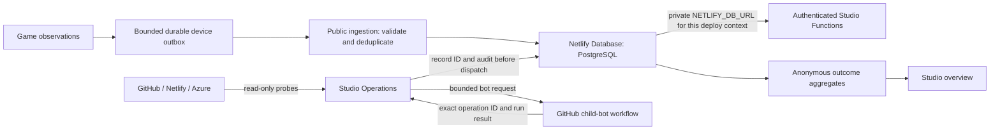
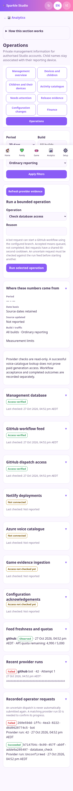
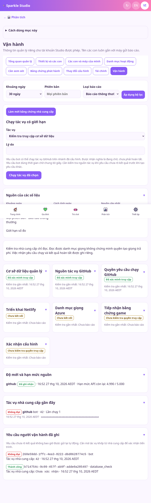
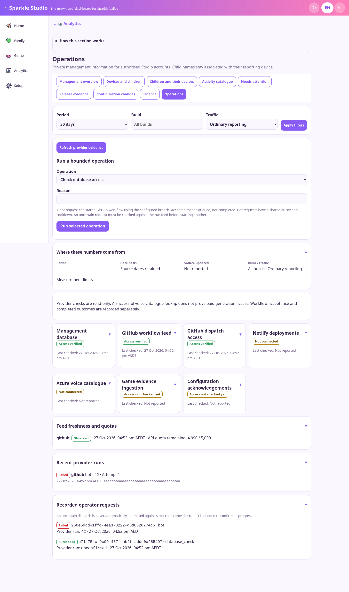

# Netlify SQL, game evidence and Studio operations

27 October 2026 AEDT. Manual-first finance is now authorised and implemented; see [Finance handbook](FINANCE.md). Child first names remain linked to their reporting installation, subject to Analytics and name-reporting settings.

## What connects to what

Netlify's native binding takes precedence over the legacy development binding. This preserves the database branch Netlify chooses for each preview. No connection string is sent to the game or website. No new package, build command or HTTP request provisions a database automatically.

## Event-to-source map

Every detailed event includes event/device/session/attempt IDs, occurrence time, build, environment and traffic class, optional profile first-name context and a bounded payload. Synthetic traffic is separate. Raw voice text, room codes, photos and save contents are rejected.

| Observation | Game source | Result visible in Studio | Boundary |
|---|---|---|---|
| Reportable boot phase | `players.ts` → `main.ts` / failure notice from `launch.js` | Started, ready, failed, pending, unknown; measured phase p95 | Begins after the players module evaluates. Earlier import/parse crashes are invisible. This is not full navigation-to-playable timing. |
| Built-in story | `tales.js` | Opened/completed attempts and selected-story detail | Completing the story counts; Close/Skip does not. Private family stories are excluded. |
| Guest room join | `net.ts` | Direct/relay attempts, authenticated host hello, actual timeout/rejection | Starting fallback does not prove direct failure. Closing without a terminal result stays pending/unknown. Hosting/reconnect coverage is unfinished. |
| Voice playback | `voice.ts` | Recorded/family/device success, failure, cancellation, unknown | Actual ended callback confirms playback; a watchdog is unknown. No spoken text is transmitted. |
| Service-worker update | `launch.js` → `players.ts` | Observed controller-change success or installation failure | Only observed attempts can report. Reload fallback alone is not success. |
| Export | `state.ts`, `ui-settings.ts` | Download initiated, share handoff, cancellation/failure | A browser cannot prove the downloaded file was saved or a share destination retained it. |
| Restore | Same save sources, persisted snapshot readback | Browser-local persistence success/failure | Not a PostgreSQL disaster-recovery drill; existing consent changes still apply. |

`core/events.ts` is a default-off, anonymous memory bridge for the consented lazy telemetry import, capped at 64 records. `management-telemetry.ts` persists bounded retry bodies. Original occurrence time and attempt identity survive the import. Revoking Analytics clears the management queue and invalidates pending callbacks. Profile context reflects reporting-device state at enqueue time; it is not proof of a specific child's action.

## Safe operational controls

| Control or feed | Exact implementation | Evidence |
|---|---|---|
| GitHub feed | Recent 20 workflow runs, sanitized run ID/state/attempt/SHA | Recent observations only; not a complete historical success rate |
| Netlify feed | Recent 10 deploys | Observed deployment state, not a deployment command |
| Azure check | Voice-catalogue GET | Does not prove synthesis permission, audio quality or available paid quota |
| Database check | Read current configuration through the bound adapter | Read access only; schema/TLS checks use the operator preflight tool |
| Configuration retry | Existing version-locked public projection | Publication/readback outcome, not proof every device applied it |
| Child-bot run | Only `nightly-child-bots.yml`, configured branch; 1–10 sessions, 1–30 minutes, three allowlisted profiles | Queued after acceptance; matching UUID from that workflow resolves outcome |

All mutations need authenticated permissions, reason, stable UUID, a durable request and immutable audit before execution. Concurrent identical requests dispatch once; changed payloads under an existing UUID conflict. Bot requests share a 60-second database-backed cooldown. Network ambiguity is unknown and is never automatically resent. Feed probes use bounded responses, timeout, single-flight refresh and caching; failed probes retain old observations labelled stale. Quotas absent from provider headers stay unavailable. Credentials and provider response bodies never enter Studio errors.

Manual refresh reconciles recent runs. Continuous background reconciliation, complete history, database recovery automation and retention are follow-up work. The online Studio can run controls; desktop keys remain scoped to reads.

## Actual Studio screen captures

Synthetic records and stub provider responses, with real sign-in, UI and server routes. These are not live Netlify health claims.

| Phone | Tablet | Computer |
|---|---|---|
|  |  |  |

## Netlify setup and verification

Use the existing project's **Data & Storage → Database**. Keep `NETLIFY_DB_URL` private and use the context-specific binding. Run preflight and the explicit migration tool in trusted operator tooling against the intended preview database, then test sign-in, configuration readback and a real device receipt. Production migration and deployment are separate release actions. This workspace has validated local PostgreSQL, not the user's Netlify account.

Official documentation checked 27 October 2026 AEDT:

- [Add Netlify Database to an existing project](https://docs.netlify.com/build/data-and-storage/netlify-database/getting-started/)
- [Existing pg driver and NETLIFY_DB_URL](https://docs.netlify.com/build/data-and-storage/netlify-database/tooling/#database-drivers)
- [Manual migration responsibilities](https://docs.netlify.com/build/data-and-storage/netlify-database/migrations/#manual-migrations)

See [implementation](IMPLEMENTATION.md) for setup commands and remaining scope, and [validation](IMPLEMENTATION-VALIDATION.md) for recorded evidence. The static Netlify ZIP does not contain server functions; use the repository deployment workflow to publish those after release review.
