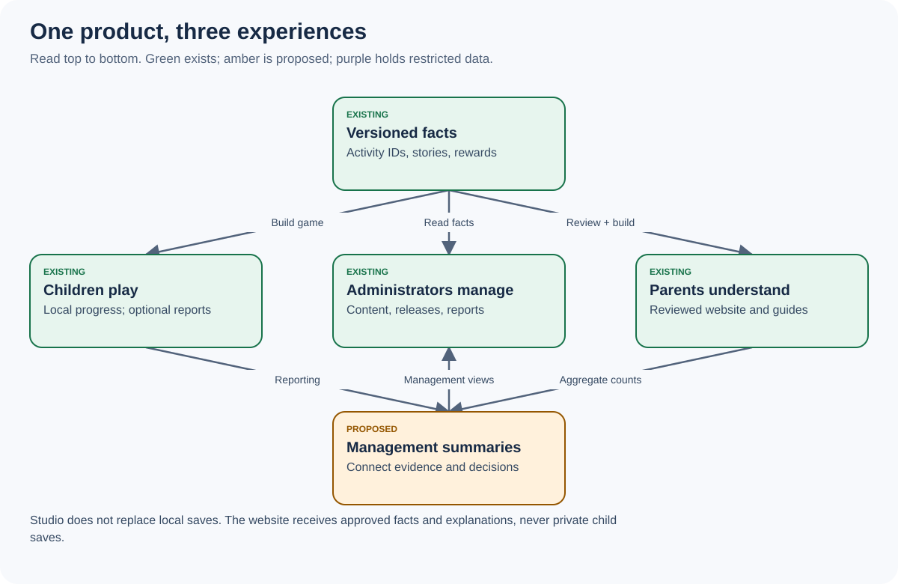

# Sparkle Valley: Studio management foundation

> **Implementation update — 27 October 2026 AEDT:** the owner has authorised implementation, requested child names with their devices and one active agent, and has now authorised manual-first finance and the full suite. [Current implementation, limits and setup](IMPLEMENTATION.md) supersedes the earlier proposed-only scope below. The original data register remains a historical design baseline.

Written 26 October 2026, Australia/Sydney (AEDT). Source baseline: `ac76cf6097a8071bf2da4be90fe81fd0af8201d6`, game and Studio `v1.01`.

**Purpose:** give the owner, a new developer and a future AI the same understandable, traceable instructions for connecting game, website, Studio and business operations. This package specifies a proposed management expansion. It does not implement that expansion or authorise a live release.

The owner selected **Netlify Database** for SQL. See [Netlify setup and operational connections](NETLIFY-AND-OPERATIONS.md) for the native binding, game event map, controls and evidence limits.

Finance is now authorised and implemented in code: [Finance handbook](FINANCE.md). [Plan-to-code traceability](PLAN-TRACEABILITY.md) maps every original B01–B12 ticket to its implementation and gaps.

## Open the visual guide first

Open **[index.html](index.html)** in a browser. It works offline, including search and filters, without a server, external libraries or analytics. It explains the system, lets you search every registered data point, and links to the detailed instructions. A PDF can be produced with the browser's Print command; the Markdown remains the canonical narrative.



## Reading routes

| Reader | Read in this order | Outcome |
|---|---|---|
| Owner / nontechnical reader | [Handbook](HANDBOOK.md), visual guide, [screens and operations](05-SCREENS-AND-OPERATIONS.md) | Understand what happens, what each number means and which decisions Studio supports |
| Business analyst | [Current system](01-CURRENT-SYSTEM.md), [data dictionary](02-DATA-DICTIONARY.md), [metrics](03-METRICS.md), [decisions](08-DECISIONS.md) | Separate measurements from assumptions and define useful decisions |
| Builder / AI | Handbook, current system, [contracts](04-CONTRACTS.md), [build plan](06-BUILD-PLAN.md), [validation](07-VALIDATION.md) | Implement one bounded ticket with known dependencies and acceptance evidence |
| Infrastructure operator | Contracts, screens/operations, [runbooks](09-RUNBOOKS.md), decisions | Understand storage, access, reliability, cost, recovery and release boundaries |

## Package contents

- [HANDBOOK.md](HANDBOOK.md): plain-language explanation, end-to-end examples and glossary.
- [01-CURRENT-SYSTEM.md](01-CURRENT-SYSTEM.md): implementation evidence and limitations at the pinned source.
- [02-DATA-DICTIONARY.md](02-DATA-DICTIONARY.md): source → transport → storage → Studio destination for each field family, with compact telemetry slots expanded.
- [03-METRICS.md](03-METRICS.md): formulas, units, denominators and interpretation limits.
- [04-CONTRACTS.md](04-CONTRACTS.md): proposed APIs, event lifecycle, schemas, concurrency and SQL reference structure.
- [05-SCREENS-AND-OPERATIONS.md](05-SCREENS-AND-OPERATIONS.md): navigation, screens, permissions, operator actions and mobile requirements.
- [06-BUILD-PLAN.md](06-BUILD-PLAN.md): ordered B01–B12 tickets with files, dependencies and acceptance criteria.
- [07-VALIDATION.md](07-VALIDATION.md): reproducible scenarios, numerical examples and release acceptance.
- [08-DECISIONS.md](08-DECISIONS.md): defaults, reserved decisions, risks and non-goals.
- [09-RUNBOOKS.md](09-RUNBOOKS.md): daily/weekly operations and failure recovery.
- [data-points.json](data-points.json), [CSV](data-points.csv), [connections.json](connections.json), [metrics.json](metrics.json): searchable and machine-readable registers.
- [schemas/event.schema.json](schemas/event.schema.json), [schemas/read-model.schema.json](schemas/read-model.schema.json), [examples/events.json](examples/events.json): proposed wire examples; never submit them to production.
- [Configuration receipt schema](schemas/config-receipt.schema.json), [finance import schema](schemas/finance-line.schema.json), and [source evidence hashes](source-evidence.json): machine-checkable shapes and pinned implementation provenance.
- [requirements.json](requirements.json): requirement → ticket → acceptance mapping.
- [images/](images/): six actual SVG diagrams, a Home wireframe and a PNG system overview.
- [tools/build.py](tools/build.py): regenerate registries, diagrams and HTML from checked-in definitions.
- [tools/validate.py](tools/validate.py): validate IDs, source paths, schema fixtures, links and generated artefact consistency.
- [tools/package.py](tools/package.py) and [MANIFEST.sha256](MANIFEST.sha256): create a ZIP with verified file hashes; existing output files are never overwritten.
- [VALIDATION-REPORT.md](VALIDATION-REPORT.md): evidence for this documentation package, separate from product validation.

## Status language

**Existing** means found in source at the pinned baseline. **Existing-derived** means a limited metric can be calculated from existing records, not that every new screen exists. **Proposed** means work is required. **Unavailable** means no trustworthy input. **Reserved decision** means the owner or infrastructure provider must supply a choice before the dependent implementation.

Existing source and approved project rules remain authoritative for the running game. Proposed schemas here do not silently replace existing APIs, permission presets, storage or save formats. If implementing this design conflicts with an existing rule, record the conflict and resolve it before changing runtime behavior.

## Maintenance

From the repository root:

```sh
python3 docs/studio-management-foundation/tools/build.py
python3 docs/studio-management-foundation/tools/validate.py
```

The builder uses Python's standard library. Schema validation uses `jsonschema==4.26.0`, already present in the inspected cloud machine. On another machine install [tools/requirements.txt](tools/requirements.txt) into a separate documentation virtual environment; do not edit the game's package manifests. The HTML guide itself has no dependency installation. To reproduce the browser review with the repository's pinned Playwright installed, run `node docs/studio-management-foundation/tools/review.mjs` from the repository root; it writes synthetic artifact evidence, not production data.

After validation and evidence updates, make a portable copy with `python3 docs/studio-management-foundation/tools/package.py /tmp/studio-foundation.zip`. Extract the whole folder and open `index.html`; the reading guide works without the repository or network. Source-hash validation and the browser checker require the repository checkout and their documented tools. Repackage after edits so the checksum manifest matches the final evidence.

Edit the generator for registry/diagram/HTML changes, then regenerate. Edit narrative Markdown and schemas directly. Update the baseline only after rechecking source behavior. Commit the source and generated copies together. Do not put secret values, real child data, production screenshots or billing documents in this package. Example records are synthetic.

This is a private single-organisation administration design. Multi-organisation billing, cloud synchronisation of children's progress and an educational assessment system are outside scope. No application deployment, financial transaction, credential grant or external message is authorised by these documents.


## Publishing validation evidence

Keep the original runner artifacts linked to their GitHub run. Documentation
uses plain text rather than phone emoji, including copied console logs. Before
adding a Markdown/text log, run:

```sh
node docs/studio-management-foundation/tools/normalize-evidence.mjs docs/studio-management-foundation/evidence/your-report.txt
```

This only replaces pictographic status markers with PASS/FAIL/NOTE or an explicit
Unicode code-point label. It does not change numbers, outcomes or assertions.
Keep structured result payloads intact; a reserialized JSON evidence copy may use
Unicode escapes. Run the normal `emoji` check before publishing, along with the
other required checks. Never edit a result from failed to passed.


For this implementation review, dispatch the existing GitHub **Full suite**
workflow on `review/studio-finance-20261027` with **Check every reading item, film
and voice area** enabled (`all=true`). This uses the repository's comprehensive
mode rather than rotating samples. The exact tested commit, result and any
retries belong in [implementation validation](IMPLEMENTATION-VALIDATION.md).
A full run belongs on GitHub; do not run two local suites together.


The guide and its pictures are included for offline reading. Source-code links
open the exact tested GitHub commit and need a connection when clicked; they do
not load automatically. For offline code review, use the separate source overlay
with the existing repository, following its review README.
