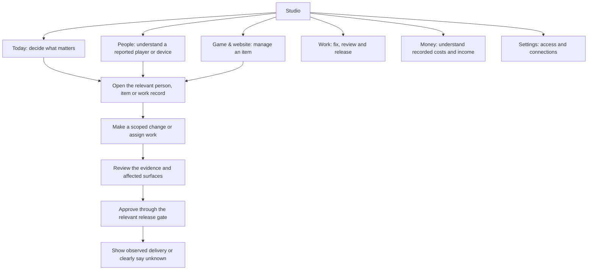
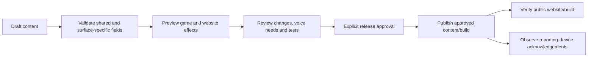

# Owner’s Desk: how the proposed Studio would work

27 October 2026 AEDT. Design expansion requested by the owner. This develops Concept A as a recommendation; the owner has not selected the final direction. Runtime implementation remains paused for design review. Examples below are fictional. Proposed workflows are not a claim that their supporting features already exist.

## The organising idea

Studio should help an owner answer: **What needs me, who is affected, what can I change, and did it work?**

Five main destinations, with Settings separate. Use one persistent navigation, one page title, and one obvious next action. A selected item opens a focused detail page with a stable Back path. Technical evidence and long histories are available within that item.

The private Studio manages shared records and approved changes. The public website explains the game and leads to play. The game runs on devices and reports only permitted observations. These are separate surfaces with a shared content/release contract, not interchangeable logins or unrestricted access to family saves.

## 1. Today: a short daily briefing

The first screen answers three questions, in this order:

1. **Does something need my decision?** One prominent issue with its consequence and a clear action. If nothing needs attention, say so; do not manufacture urgency.
2. **What else needs attention?** A short ordered queue: player problems, reviews awaiting approval, approaching commitments. Each row explains why it matters and who owns the next action.
3. **What changed?** A few quiet summary figures and recent work, with a link to the relevant detail.

Illustrative wording: “Two reporting devices still have the previous release. Check update status.” This describes observed devices, not all installed devices or all children. An offline device is not automatically a failed update.

Keep charts and catalogue totals inside their relevant areas. A large recording inventory can help a voice editor; it rarely deserves the owner’s most prominent home-page position.

## 2. People: a useful child-and-device view

Start with a searchable list of reported names and associated devices, within the signed-in operator’s actual permissions. A name is a display label; persistent IDs provide identity. Two children called Linh are not automatically one person. A shared tablet may have several profiles. Cross-device linking requires an explicit supported relationship, not matching names.

Selecting an authorised record reveals:

| Area | Plain-language presentation | Boundary |
|---|---|---|
| Identity | Reported first name, device nickname/type, language | No surname requirement; never infer a global child identity |
| Last observation | Last reported time, game version, online status if actually observed | “Last reported” does not mean live surveillance |
| Problems | Relevant reports and reproducible symptoms | Absence of reports does not establish absence of problems |
| Delivery | Desired change, server availability, device acknowledgement | Saved, available and applied are distinct |
| Recent activity | Relevant permitted observations | Consent/analytics opt-outs and retention remain enforced |
| Available actions | View report; create work; review an authorised scoped setting | Never silently edit purchases, rewards or saved progress |

Example journey: **Today → reported tablet problem → associated child/device → original report → create fix work → review evidence → observe release delivery.** The person, device, report and work record retain links so the owner does not re-find them on separate pages.

An opt-out or missing observation displays “Not collected” or “Unknown”, with a short explanation. It does not display a reassuring green zero.

## 3. Game & website: edit the thing once, inspect its effects

Choose an item first: a game, story, place, recording or public page. Its detail page shows the current public version and any draft. Relevant sections appear inside that item, rather than as new global menus.

For one game, the proposed editor contains:

- **Overview:** purpose, audience where explicitly defined, current release, availability and outstanding work.
- **Content:** the actual editable fields, with EN/VI completeness and validation.
- **Website:** the related public description, images and links, distinguishing shared fields from website-only fields.
- **Voice & media:** assets used by this item, missing recordings and review status.
- **Review:** before/after changes, affected surfaces, test evidence and blockers.

Use one primary action appropriate to the stage: **Save draft**, then **Request review**, then the authorised release action. Saving a draft does not publish the website, change every device or regenerate voices automatically.

Example: change the introduction for Ô Ăn Quan. Studio identifies the shared introduction and related website text, flags any recording that needs review, and previews both surfaces. It does not assume every similar paragraph is the same field. A release can be live on the website while some devices still report the previous version; both facts remain visible.

## 4. Work: give every problem a next step

Work holds bugs, content changes, reviews and releases. Start with an ordered list; offer a board when coordinating several tasks. The board is a view of the same records, not another competing workflow.

Every work item should answer:

| Question | Required information |
|---|---|
| What is wrong or requested? | Short title, expected result, observed result |
| Why does it matter? | Impact and urgency with an explanation |
| Who is affected? | Linked permitted devices, content or public surfaces |
| Who acts next? | Responsible person/role and a concrete next step |
| What proves it is ready? | Linked changes, relevant tests and visual review |
| What happened? | Review decision, release reference and observed result |

Proposed stages: **Needs attention → In progress → Ready for review → Live / verified**. A task may also be blocked or closed without release, with its reason. Dragging a card cannot deploy code, approve spending or prove a fix reached a device. Release state comes from actual approval and delivery evidence.

## 5. Money: clear records before impressive charts

The first view should explain **what is recorded, what is due, and how complete the records are**. It should not imply a complete company financial picture from a few manually entered invoices.

| First-view item | Meaning and caveat |
|---|---|
| Recorded income and costs | Period, currency, basis and included sources visible |
| Upcoming obligations | Due date, payee, commitment and settlement status |
| Budget position | Recorded eligible costs against an explicit budget |
| Missing coverage | Sources/periods not yet supplied or reconciled |
| Next action | Import an invoice, review a duplicate or resolve a discrepancy |

The invoice detail holds the document reference, supplier, service period, original currency, tax, FX assumptions, credits and correction history. Import shows a preview before confirmation. An unchanged duplicate should be identified instead of silently counted again.

Cash, incurred cost and commitments are distinct. Different currencies are not summed without explicit supported conversion. Unit cost uses a clearly named observed denominator; incomplete reporting is disclosed. Company profit, cash runway and revenue per child require suitable complete inputs and definitions before becoming reliable headline figures.

Recording an invoice or marking its status never sends a bank payment. Source completeness matters more than decorative forecast graphs.

## A realistic morning using this design

1. Open Today. See one player problem requiring review and one draft awaiting a decision.
2. Open the problem. See the affected reporting device, associated name where permitted, version and original evidence together.
3. Assign the next action in Work. Return to Today without losing place.
4. Open the draft game introduction. Compare the game and website previews, including EN/VI and recording impacts.
5. Review the release evidence. Approval remains an explicit action under the existing release rules.
6. Open Money. Review a due hosting invoice and see whether the selected period’s source coverage is complete.

This is a proposed connected journey, not a promise that every step takes one click or that a whole company can be accurately summarised in seconds.

## Visual direction and interaction

- Warm white background, dark readable text and one restrained accent colour. Status always includes words; colour is secondary.
- Use the [existing A desktop mockup](a-desktop.png) and [phone mockup](a-phone.png) as the starting visual direction. Those are initial concept renders, not renders of all the detailed flows in this document.
- Lists for repeated records, headings for structure, cards only for genuinely separate tasks. Give the primary decision more emphasis than metadata.
- Desktop: one sidebar and a generous work area. Tablet: a compact navigation with the same labels. Phone: five short labelled destinations; one focused list or detail at a time.
- Keep the header stable and Back predictable. Retain list filters/scroll when returning from an item. Avoid nested overlays and large moving panels.
- Show purpose, scope and when an action takes effect beside the relevant control. Detailed technical explanations can expand; essential touch guidance remains visible.
- Adult targets at least 44 px. EN/VI labels, keyboard focus, errors, loading, empty states and safe-area/keyboard behaviour are part of the design.
- Global search is a later supporting feature: results must follow permissions and explicitly state their search coverage. Navigation must work without it.

## What would happen to the existing pages?

This is a workflow redesign, not a target to rename 41 pages into five cards. Existing capabilities need a disposition inventory before migration:

| Current capability | Proposed home | Treatment |
|---|---|---|
| Overview and attention summaries | Today | Select decisions; move supporting detail into the relevant record |
| Reported children, devices and family tools | People | Preserve permission boundaries and distinguish reporting from authorised family editing |
| Catalogue, stories, media and voices | Game & website | Contextual item editors; specialist bulk tools remain accessible where useful |
| Public website content | Game & website | Identify shared sources and website-specific fields before enabling edits |
| Bugs, operations, tests and releases | Work | Link work to real execution evidence; retain specialist operational detail |
| Ledger, imports, commitments and budgets | Money | Preserve current financial validation and audit history |
| Roles, connections and administration | Settings | Occasional tasks with clear access and connection states |
| Analytics and exports | Relevant area | Keep useful analysis available on demand with definitions and coverage |

This is a category map. An exact route-by-route migration and permission inventory is still required; no existing tool is silently removed by this proposal.

## Build and review sequence

1. **Agree the structure and visual direction.** Expand four connected prototype flows: Today; a child/device problem; a game-and-website draft; Money. Include Work where those journeys create a task or reach review. Use clearly fictional data.
2. **Review the difficult states.** Empty account, incomplete data, denied permission, offline device, validation error, conflicting edit, pending review and partial delivery. Review EN/VI and phone/tablet/desktop.
3. **Inventory and map existing capability.** Route, permission, data source, action, destination and replacement status. Identify missing backend contracts separately from layout work.
4. **Implement a shared shell and one complete journey.** Reuse working backend and validation where suitable. Connect real scoped reads/actions and prove the journey before expanding.
5. **Migrate remaining tools deliberately.** Add a contextual entry for each retained capability, verify access, and retire an old route only once its replacement is verified.
6. **Validate and seek release approval.** Relevant automated checks, comprehensive regression under repository policy, visual review and documented physical-device limits. No deployment or version change follows from approving a concept alone.

Success is measured by the owner completing representative tasks without hunting through unrelated pages, understanding which device/surface a change affects, and correctly distinguishing saved, approved, published and applied. Prototype review should record where the owner hesitates; visual cleanliness alone is insufficient.

## What is reusable and what remains work

Existing finance validation, data permissions, SQL adapters, bounded telemetry and release evidence can support the redesign. Their existence does not make a new editor or connected workflow complete. The navigation, presentation, contextual relationships, previews, route migration and missing action contracts require further implementation.

This is substantial Studio product work with selective backend additions. An implementation estimate should follow the capability inventory and approved prototype rather than assuming it is a cosmetic reskin or discarding all prior work.
