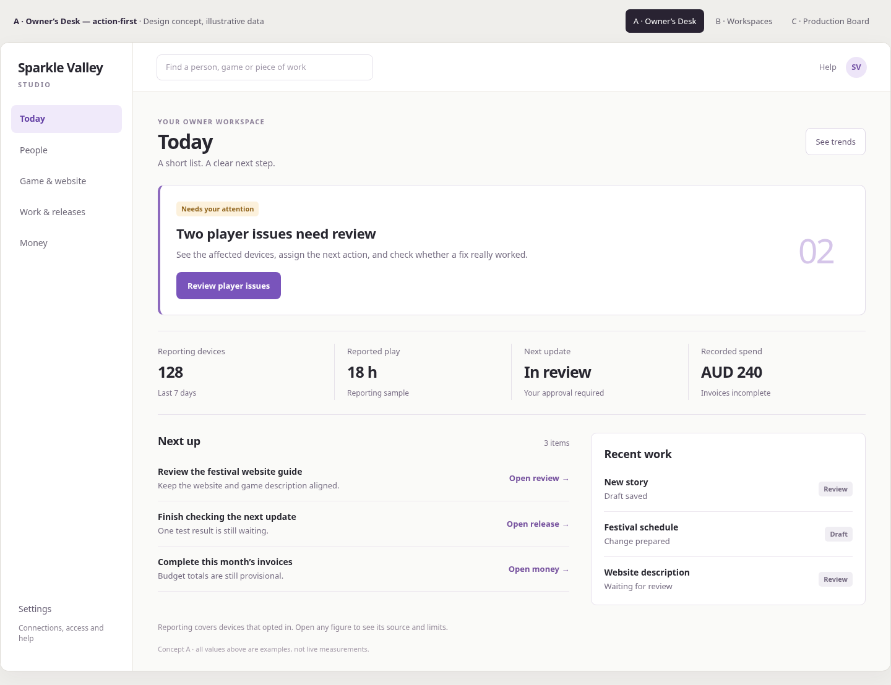
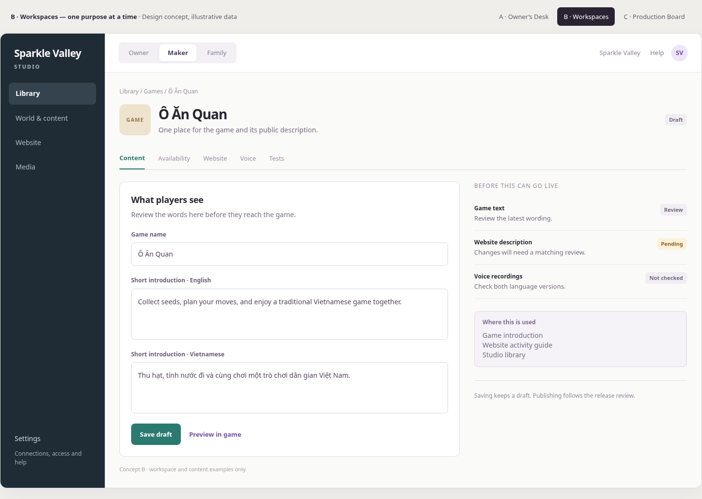
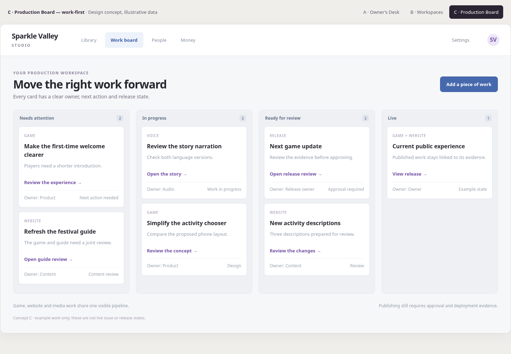

# Studio redesign: concepts before implementation

27 October 2026 AEDT. The owner found the current Studio confusing and asked for an entire redesign, starting with concepts. Product implementation is paused for this review. These are visual proposals with illustrative data, not deployed screens or new backend features.

## What the existing approach got wrong

The work added capabilities without resolving the product's structure. A family editor, game builder and company console now compete for attention. New management views sit inside an already crowded Analytics section. The interface repeats side navigation, subnavigation, help panels, filters and collapsible cards. On a phone, those layers push the useful work down the screen.

The Home page prioritises inventory counts over decisions. A large voice-recording count does not tell an owner what to do next. Numerous equally styled panels and buttons give everything similar visual weight. The result is functional breadth without a coherent daily workflow.

The redesign must address information architecture, task flow, hierarchy, language and mobile interaction together.

## A. Owner's Desk — recommended main direction

**Best for:** the owner acting as CEO/CFO and daily operator.

Five primary destinations: **Today, People, Game & website, Work & releases, Money**. Settings and connections sit separately. Today leads with the most important action, followed by a small secondary summary and a short work queue. Trends belong inside the relevant area.

Example journey: see a player problem → inspect the affected devices → assign a next action → review the fix and test evidence. A family/child record stays linked to its device; the interface does not infer a global child identity or expose saved progress for editing.

| Destination | What belongs there |
|---|---|
| Today | Priorities, important exceptions, a few summary figures and recent work |
| People | Reported children and devices, device health, and explicitly authorised family tools |
| Game & website | Games, stories, world/content, availability, public descriptions, voice and media in context |
| Work & releases | Problems, assignments, tests, reviews, release approval and delivery evidence |
| Money | Recorded income/costs, invoices, commitments, budgets and qualified forecasts |
| Settings | Connections, roles, security and other occasional administration |

**Tradeoff:** advanced editing tools are one deliberate step deeper. Every important capability needs a clear contextual entry, search and an understandable back path.

[Full desktop image](a-desktop.png) · [Phone image](a-phone.png)

## B. Purpose-based workspaces

**Best for:** distinct owner, content-maker and family tasks.

Switch between **Owner, Maker and Family**, each with a small, relevant navigation. The example shows Maker: choose a game once, then manage its content, availability, website description, voice and tests in the same item workspace. It replaces scattered global settings with an understandable object and its consequences.

Example journey: choose Ô Ăn Quan → edit a draft introduction → see the matching website and voice review requirements → submit the change for release review. Family tools require their actual authorised family scope; a workspace switch never grants access.

**Tradeoff:** changing jobs requires a workspace switch. This makes sense when different people have different responsibilities; a sole owner may prefer Concept A's continuous view.

[Full desktop image](b-desktop.png) · [Phone image](b-phone.png)

## C. Production Board

**Best for:** coordinating a team's ongoing game, website and media work.

The main view is a pipeline: **Needs attention → In progress → Ready for review → Live**. Cards identify the work, responsible role and next action. A review item opens one focused inspector instead of a page full of unrelated controls. On a phone, select one stage at a time.

Example journey: find a blocked website/game review → assign responsibility → inspect the change and evidence → request approval. Moving a card does not deploy code or establish that a release is live; the real release gate and deployment evidence remain necessary.

**Tradeoff:** this is strongest for work coordination. Player health and financial review still need their own focused views.

[Full desktop image](c-desktop.png) · [Phone image](c-phone.png)

## Recommendation and shared rules

Use **A as the Studio's main structure**. Use B's single-item editing inside Game & website. Use C's board as an optional view inside Work & releases. The owner sees one navigation system and opens a specialised view when needed.

- One primary action per screen, clear hierarchy and generous spacing.
- Contextual tools after selecting a person, activity or release.
- Plain language: Draft, Needs review, Waiting for devices, Incomplete.
- Sources, technical detail and long explanations available on demand.
- Financial completeness and unknown states remain honest; unavailable is not zero.
- Fewer cards, quieter status colours and consistent controls.
- Phone layouts are designed independently: short navigation, focused editors and one work stage at a time.
- Permissions remain enforced by the server. Family content, business finance and public game/website content keep distinct access boundaries.
- Draft → review changes and impact → approval → verified application. A saved edit is never presented as universal delivery.

The next design review should cover **Today, one person/device detail, one game-and-website editor, and Money**, on desktop and phone. Review those task flows before migrating the existing pages. No runtime redesign is authorised by these concept files alone.

## Preview and provenance

Open `index.html` locally to switch concepts. Action buttons only display a concept notice. All numbers and work items are illustrative. No production API, provider credentials or family records are used. The screenshots are rendered directly from this checked-in HTML; `validation.json` records the layout and interaction checks.
