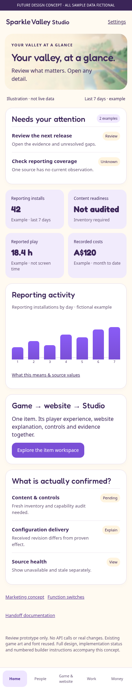
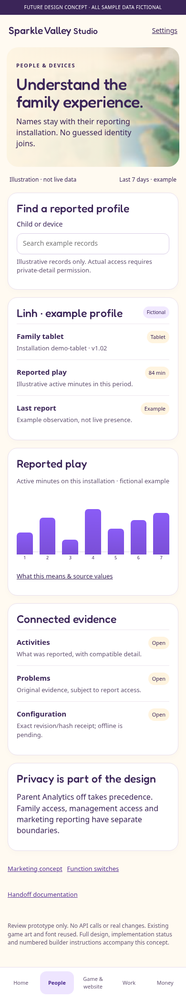
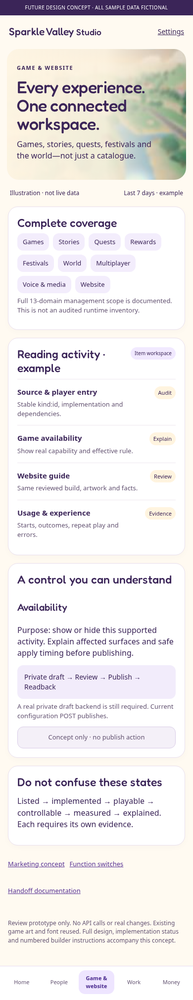
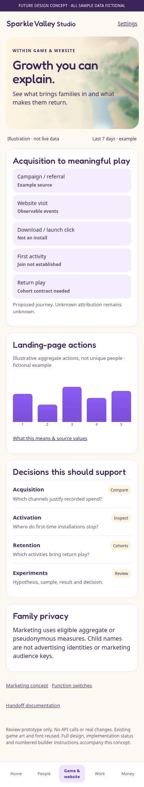
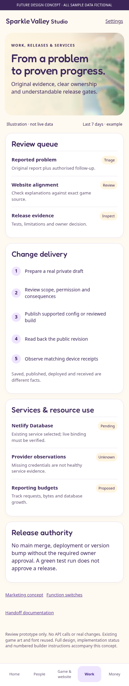
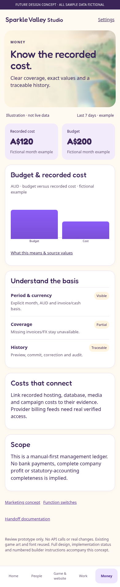
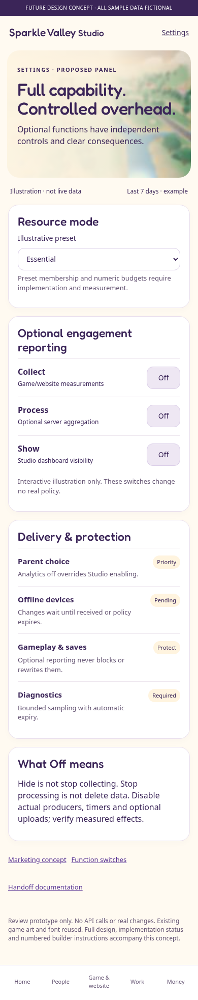

# iPhone visual concept

These are **proposed designs with fictional example data**, not implemented application screenshots. Tap an image to enlarge. No code viewer or PDF is required.

## Home: quick review

## People and devices

## Connected game and website

## Marketing decisions

## Work, releases and services

## Money

## Optional-function switches

## Full system

The detailed field/connection contracts remain authoritative; arrows do not grant access or establish identity joins.
