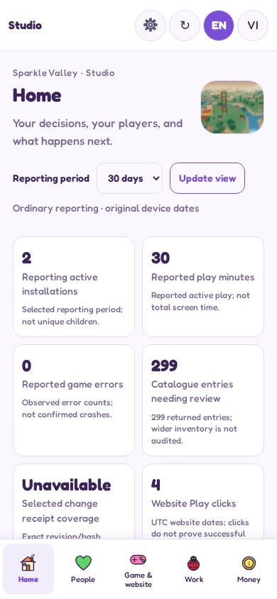
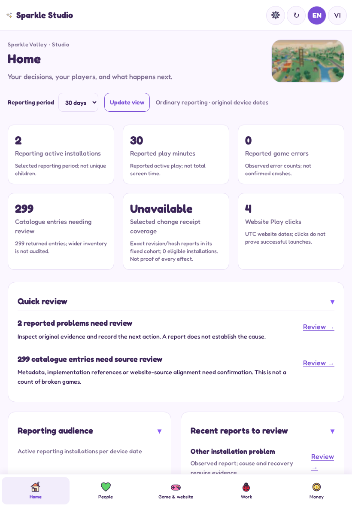
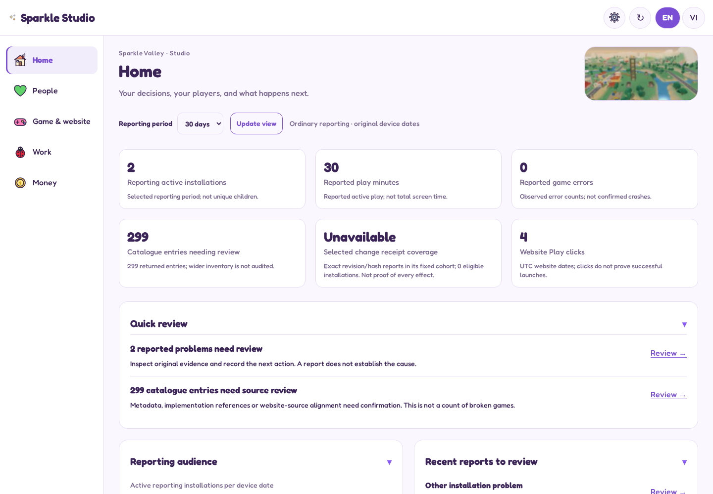
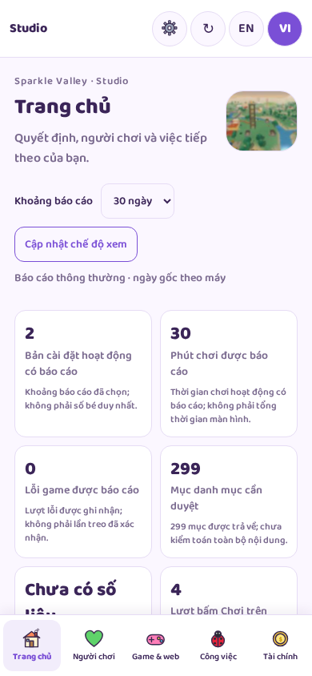
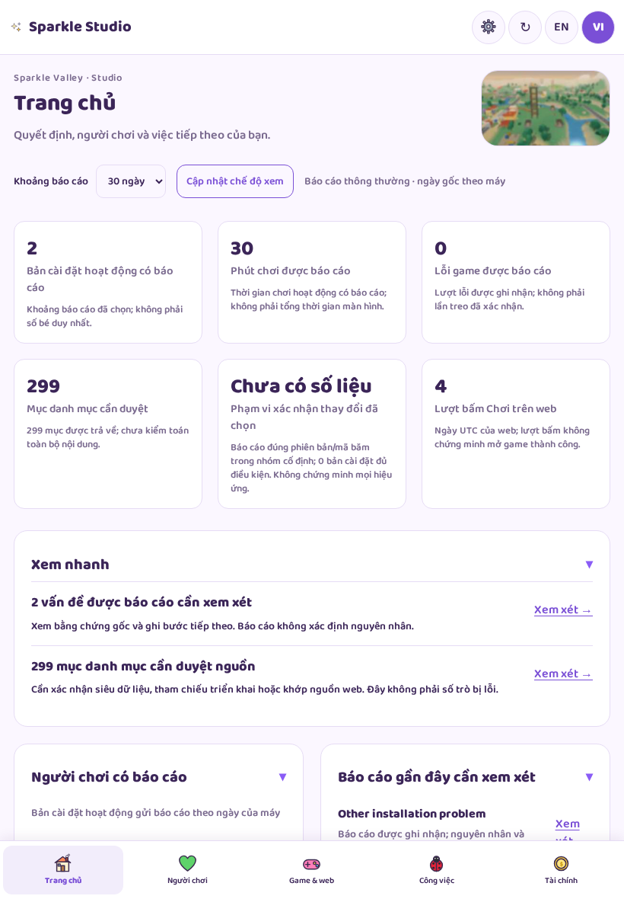
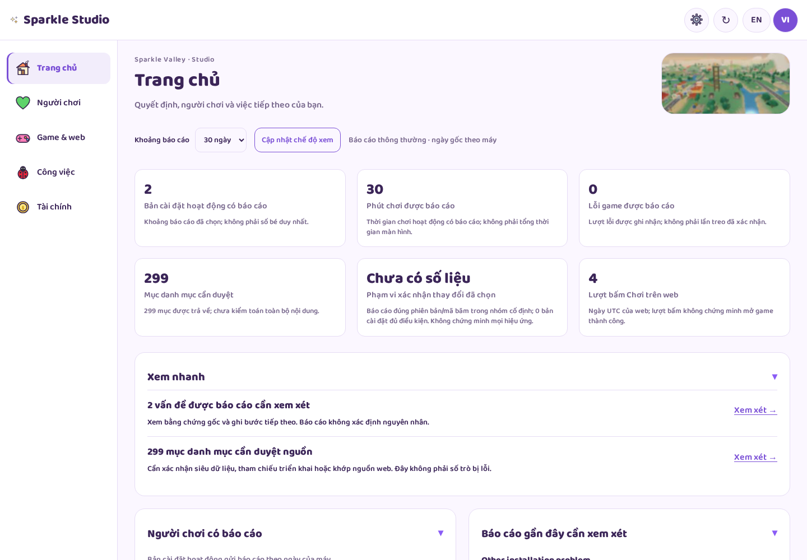

# Actual Studio review images

Actual implemented UI with synthetic records. Browser emulation; not a live production or physical-device capture. Full-size images preserve each test output; viewport images are the clearest quick review on iPhone.

## English

### Home · 390px

[Full page](screenshots/en-390-today.png)

### Home · 820px

[Full page](screenshots/en-820-today.png)

### Home · 1440px

[Full page](screenshots/en-1440-today.png)

## Vietnamese

### Home · 390px

[Full page](screenshots/vi-390-today.png)

### Home · 820px

[Full page](screenshots/vi-820-today.png)

### Home · 1440px

[Full page](screenshots/vi-1440-today.png)

## Other retained flows

People, selected installation detail, game catalogue, Work and Money were captured at the same EN/VI/device sizes. Their PNGs are in screenshots/. Their presence is regression evidence, not completion of every contextual editor.
